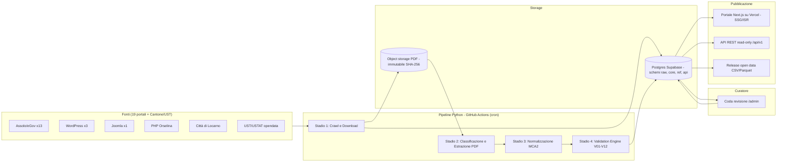
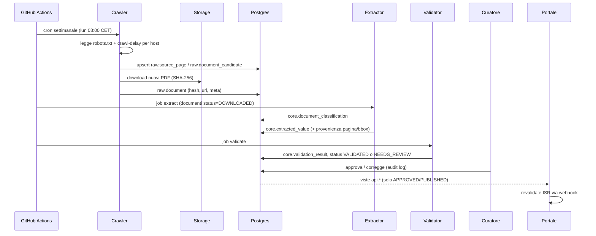

# 03 · Architettura Tecnica

## 1. Vista d'insieme



## 2. Stack e motivazioni (ADR sintetici)

| Area | Scelta | Alternativa scartata | Perché |
|---|---|---|---|
| **ADR-01 Linguaggio pipeline** | **Python 3.12** + `uv` | Node/TS | Ecosistema PDF superiore: `pdfplumber`, `PyMuPDF`, `camelot`, OCR `ocrmypdf`/Tesseract, `pandas`/`polars`, `pandera` |
| **ADR-02 Linguaggio portale** | **Next.js 15 (App Router) + TypeScript + Tailwind v4** | Astro, SvelteKit | Coerente con le competenze già dimostrate nel progetto Corfin; SSG/ISR per performance |
| **ADR-03 Database** | **Postgres su Supabase (progetto NUOVO, regione Zurigo)** | DuckDB+file statici | Serve area curatore con auth + RLS + API; Supabase già familiare e con MCP |
| **ADR-04 Storage PDF** | **Supabase Storage** (bucket privato) in v1; **Cloudflare R2** se > 10 GB | S3 | Semplicità in v1; R2 per egress gratuito se l'archivio diventa pubblico |
| **ADR-05 Orchestrazione** | **GitHub Actions cron** (repo pubblico → minuti gratis) | Vercel cron, Cloudflare Workers | Job lunghi (fino a 6 h), Python nativo, log pubblici = trasparenza |
| **ADR-06 HTTP crawling** | `httpx` async + `selectolax` + `protego` (robots) ; Playwright solo fallback | Scrapy | Più semplice da testare; nessun framework pesante per 19 host |
| **ADR-07 Validazione dati** | `pydantic` v2 (record) + `pandera` (dataframe) + SQL constraints | Great Expectations | Leggero, tipizzato, testabile con pytest |
| **ADR-08 Contratto dati** | Migrazioni **SQL** versionate (Supabase CLI) come *source of truth*; tipi TS generati (`supabase gen types`) | ORM condiviso | Due linguaggi → il contratto è lo schema DB |
| **ADR-09 Grafici** | `Observable Plot` o `Recharts` + mappa `MapLibre` con confini comunali swisstopo | D3 custom | Accessibili, leggeri |
| **ADR-10 Open data** | Export Parquet/CSV + `datapackage.json` pubblicati come **GitHub Release** + mirror su storage | Solo API | Riproducibile, citabile (DOI via Zenodo opzionale) |

## 3. Struttura del repository (nuovo, separato)

Cartella attiva del progetto: `C:\Users\nicol\Desktop\progetti\21.dashboard-\`

```text
21.dashboard-/
├── AGENTS.md                      # regole ADHD + 4 ruoli adattati al dominio finanza pubblica MCA2
├── README.md                      # indice generale e guardrail infrastrutturali
├── implementation_plan.md         # piano di implementazione master A->Z
├── docs/
│   ├── spec/                      # QUESTO pacchetto di spec (00..14)
│   └── ricerca-iniziale/          # documento di ricerca originario (.docx, .txt e 4 grafici .png)
├── scripts/
│   └── probe-portali-19-comuni.ps1 # diagnostica HTTP e robots.txt sui 19 portali comunali
├── registry/
│   ├── comuni.yaml                # 19 Comuni: UST, CMS, URL, enti, verified_at
│   ├── glossario.yaml             # sinonimi titoli/enti
│   └── layouts/                   # template di estrazione per famiglia di layout
├── pipeline/                      # Python (uv)
│   ├── pyproject.toml
│   ├── src/ofcl/
│   │   ├── crawl/                 # connettori: assolo.py, wordpress.py, joomla.py, orselina.py, locarno.py
│   │   ├── fetch/                 # downloader, robots, rate limit, hashing
│   │   ├── classify/              # classificatore documenti
│   │   ├── extract/               # pdf -> tabelle (layout templates, OCR, numeri ticinesi)
│   │   ├── normalize/             # mapping MCA2 (funzionale/natura)
│   │   ├── validate/              # V01..V12
│   │   ├── indicators/            # 8 indicatori SEL
│   │   ├── load/                  # upsert su Postgres
│   │   ├── export/                # CSV/Parquet/datapackage
│   │   └── cli.py                 # `ofcl crawl|extract|validate|publish|export`
│   └── tests/
│       ├── golden/                # PDF annotati + expected JSON
│       └── ...
├── supabase/
│   ├── config.toml
│   ├── migrations/                # 0001_init_schemas.sql ...
│   └── seed/                      # ref tables (piano conti MCA2, scale SEL, comuni)
├── web/                           # Next.js portale + /admin curatore
│   ├── src/app/(public)/...
│   ├── src/app/admin/...
│   └── src/lib/supabase/
└── .github/workflows/
    ├── ci.yml                     # lint + test pipeline + build web
    ├── crawl-weekly.yml           # cron
    ├── extract-on-new.yml         # dispatch dopo crawl
    └── release-opendata.yml       # su tag dati
```

## 4. Flusso dati dettagliato



## 5. Schemi del database (separazione per livello)

| Schema | Contenuto | Accesso |
|---|---|---|
| `raw` | Pagine sorgente, documenti, log di crawl | solo `service_role` |
| `core` | Classificazioni, valori estratti, validazioni, crediti, cespiti | `service_role` + curatore autenticato |
| `ref` | Comuni, enti, piano dei conti MCA2, scale SEL, popolazione, moltiplicatori | lettura pubblica |
| `api` | **Viste** pubbliche (solo dati `PUBLISHED`) | `anon` SELECT |
| `audit` | Log immutabile delle azioni del curatore | solo `service_role` |

Dettaglio in `04-data-model.md`.

## 6. Sicurezza

- **RLS attiva su tutte le tabelle**; `anon` vede solo lo schema `api` (viste `security_invoker`), nessuna tabella base esposta.
- Area `/admin`: Supabase Auth (email + **MFA TOTP**), ruolo `curator` in `app_metadata` (non modificabile dall'utente).
- La pipeline usa `SUPABASE_SERVICE_ROLE_KEY` **solo** in GitHub Actions Secrets (environment protetto `production`).
- Nessuna chiave service role nel portale; il portale usa la chiave pubblica + viste.
- Download PDF: controllo MIME, dimensione max (150 MB), nessuna esecuzione di contenuti; parsing in sandbox del runner.
- Headers: CSP restrittiva, `X-Robots-Tag` normali (il portale *vuole* essere indicizzato).
- Rate limit API: Vercel Firewall / middleware (es. 60 req/min/IP).

## 7. Osservabilità

- Ogni run della pipeline produce `run_report.json` (documenti trovati/nuovi/estratti/falliti per Comune) caricato come artifact e salvato in `raw.pipeline_run`.
- Pagina pubblica **/stato** con salute dei connettori (ultimo successo per Comune) → trasparenza.
- Alert (email/GitHub issue automatica) se: connettore con 0 risultati 2 settimane di fila; validazione BLOCKING; job fallito.

## 8. Stima costi mensili (regime)

| Voce | Piano | CHF/mese |
|---|---|---|
| Supabase | Free → Pro se servono backup PITR | 0 → ~25 |
| Vercel | Hobby (non commerciale) → Pro se necessario | 0 → ~20 |
| GitHub Actions | Repo pubblico | 0 |
| Storage PDF (~5–15 GB) | Supabase Storage incluso / R2 | 0 – 2 |
| Dominio `.ch` | — | ~1.5 |
| **Totale** | | **~2 – 50** |

> ⚠️ Vercel Hobby vieta l'uso commerciale: un portale civico non commerciale è compatibile, ma da verificare se in futuro ci saranno sponsor/donazioni.
