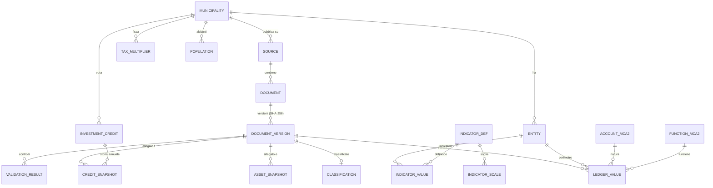

# 04 · Modello Dati

## 1. Differenze rispetto al modello del documento sorgente

| Modello sorgente | Problema | Modello OFCL |
|---|---|---|
| `fact_movimenti_mca2` PK `(ust, anno, tipo_doc, ente, conti)` | Nessuna versione (iniziale/emendato), nessuna colonna di provenienza (un preventivo T contiene anche Prev T-1 e Cons T-2), nessuna provenienza pagina | `core.ledger_value` legato a `document_id` + `column_role` + `page/bbox`; vista `api.ledger_golden` sceglie la versione autorevole |
| `ente` come ENUM hard-coded (`AET_ELETTRICA`, `APONA`…) | Ogni nuova azienda = migrazione | Tabella `ref.entity` (Comune + aziende per Comune) |
| `fact_controllo_crediti` PK con `mm_credito` | `mm_credito` può mancare o essere ambiguo | Entità `core.investment_credit` (anagrafica del credito, stabile) + `core.credit_snapshot` (una riga per consuntivo) |
| Indicatori non modellati | — | `core.indicator_value` con `source = REPORTED | COMPUTED` |
| Soglie nel testo | — | `ref.indicator_scale` versionata con fonte |

## 2. ERD



## 3. DDL (migrazione `0001_init.sql` — estratto normativo)

```sql
-- =========================================================
-- SCHEMI
-- =========================================================
create schema if not exists ref;
create schema if not exists raw;
create schema if not exists core;
create schema if not exists api;
create schema if not exists audit;

-- =========================================================
-- REF: anagrafiche e riferimenti (lettura pubblica)
-- =========================================================
create table ref.municipality (
  ust_code        smallint primary key check (ust_code between 5001 and 5999),
  slug            text not null unique,                 -- 'losone'
  name            text not null,
  seat            text,                                 -- sede cancelleria
  circle          text not null,                        -- circolo
  district_code   smallint not null default 2104,
  cms_family      text not null check (cms_family in ('ASSOLO','WORDPRESS','JOOMLA','CUSTOM_PHP','CITY_LOCARNO','UNKNOWN')),
  valid_from      date,                                 -- fusioni (Verzasca 2020-10-18)
  valid_to        date,
  merger_note     text,
  verified_at     timestamptz,                          -- C-03: null = non verificato
  created_at      timestamptz not null default now()
);

create table ref.entity (                                -- perimetro contabile
  id              uuid primary key default gen_random_uuid(),
  ust_code        smallint not null references ref.municipality,
  kind            text not null check (kind in ('COMUNE','AAP','AE','PORTO','CASA_ANZIANI','ENTE_AUTONOMO','ALTRO')),
  name            text not null,                         -- 'Azienda acqua potabile (ACAP)'
  aliases         text[] not null default '{}',          -- 'AAP','ACAP'
  unique (ust_code, kind, name)
);

create table ref.account_mca2 (                          -- piano dei conti per natura
  code            text primary key,                      -- '3010', '30', '301'
  level           smallint not null check (level between 1 and 4),
  parent_code     text references ref.account_mca2,
  label_it        text not null,
  statement       text not null check (statement in ('CE','CI','BIL')),
  source_url      text not null
);

create table ref.function_mca2 (                         -- classificazione funzionale
  code            text primary key,                      -- '0', '02', '021'
  level           smallint not null,
  parent_code     text references ref.function_mca2,
  label_it        text not null
);

create table ref.population (
  ust_code        smallint references ref.municipality,
  year            smallint not null,
  residents       integer not null check (residents > 0),
  definition      text not null default 'STATPOP_RESIDENTE_PERMANENTE_31_12',
  source_url      text not null,
  primary key (ust_code, year, definition)
);

create table ref.tax_multiplier (
  ust_code        smallint references ref.municipality,
  year            smallint not null,
  pf_pct          numeric(5,2) not null,
  pg_pct          numeric(5,2) not null,
  source_document uuid,                                  -- MM del preventivo (core)
  source_url      text,
  verification    text not null default 'UNVERIFIED' check (verification in ('UNVERIFIED','VERIFIED')),
  primary key (ust_code, year)
);

create table ref.indicator_def (
  code            text primary key,                      -- 'NET_DEBT_RATIO'
  label_it        text not null,
  formula_text    text not null,
  unit            text not null check (unit in ('PCT','CHF','CHF_PER_CAPITA')),
  higher_is_better boolean
);

create table ref.indicator_scale (
  indicator_code  text references ref.indicator_def,
  valid_from      date not null,
  valid_to        date,
  band_order      smallint not null,
  lower_bound     numeric,                               -- incluso
  upper_bound     numeric,                               -- escluso
  label_it        text not null,                         -- 'Buono'
  color_token     text not null,                         -- 'good','ok','warn','bad'
  source_url      text not null,
  primary key (indicator_code, valid_from, band_order)
);

-- =========================================================
-- RAW: acquisizione (solo service_role)
-- =========================================================
create table raw.source (
  id              uuid primary key default gen_random_uuid(),
  ust_code        smallint not null references ref.municipality,
  kind            text not null check (kind in ('MM_INDEX','CONTI_INDEX','ALBO','SESSION_INDEX','WP_CATEGORY','MANUAL')),
  url             text not null unique,
  robots_allowed  boolean,
  crawl_delay_s   integer,
  last_checked_at timestamptz,
  last_ok_at      timestamptz,
  active          boolean not null default true
);

create table raw.pipeline_run (
  id              uuid primary key default gen_random_uuid(),
  stage           text not null check (stage in ('CRAWL','EXTRACT','VALIDATE','PUBLISH','EXPORT')),
  git_sha         text not null,
  started_at      timestamptz not null default now(),
  finished_at     timestamptz,
  status          text not null default 'RUNNING' check (status in ('RUNNING','OK','PARTIAL','FAILED')),
  report          jsonb
);

create table raw.document (                               -- documento logico (un URL/oggetto)
  id              uuid primary key default gen_random_uuid(),
  ust_code        smallint not null references ref.municipality,
  source_id       uuid references raw.source,
  origin_url      text not null,
  title_raw       text,
  published_on    date,                                  -- se dichiarata dalla pagina
  first_seen_at   timestamptz not null default now(),
  offline_since   timestamptz,
  acquisition     text not null default 'CRAWLER' check (acquisition in ('CRAWLER','MANUAL_UPLOAD','LIT_REQUEST')),
  contains_personal_data boolean not null default false, -- C-04 / FR-005
  unique (ust_code, origin_url)
);

create table raw.document_version (                       -- ogni contenuto diverso = nuova versione
  id              uuid primary key default gen_random_uuid(),
  document_id     uuid not null references raw.document on delete restrict,
  sha256          char(64) not null unique,
  storage_path    text not null,                         -- pdf/{ust}/{sha256}.pdf
  bytes           bigint not null check (bytes > 0),
  mime            text not null,
  pages           integer,
  has_text_layer  boolean,
  http_etag       text,
  http_last_modified timestamptz,
  fetched_at      timestamptz not null default now(),
  status          text not null default 'DOWNLOADED' check (status in
                    ('DOWNLOADED','CLASSIFIED','EXTRACTED','VALIDATED','NEEDS_REVIEW','APPROVED','PUBLISHED','REJECTED','SUPERSEDED'))
);

-- =========================================================
-- CORE: dati estratti
-- =========================================================
create table core.classification (
  version_id      uuid primary key references raw.document_version,
  doc_type        text not null check (doc_type in ('PREVENTIVO','CONSUNTIVO','PIANO_FINANZIARIO','CREDITO_INVESTIMENTO','RAPPORTO_COMMISSIONE','ALTRO')),
  doc_subtype     text check (doc_subtype in ('CREDITO_QUADRO','SUPPLETORIO','A_POSTERIORE','REVOCA','LIQUIDAZIONE')),
  fiscal_year     smallint,                              -- anno dell'esercizio (Prev 2027 -> 2027)
  pf_from_year    smallint, pf_to_year smallint,         -- piani finanziari
  entity_id       uuid references ref.entity,
  mm_number       text,                                  -- 'MM 08/2026' normalizzato
  budget_stage    text check (budget_stage in ('PROPOSTA','EMENDATO','APPROVATO')),
  layout_family   text,                                  -- 'GECOTI_V3','CRYSTAL','UNKNOWN'
  method          text not null check (method in ('RULES','CONTENT','MANUAL')),
  confidence      numeric(4,3) not null check (confidence between 0 and 1)
);

create table core.ledger_value (                          -- riga contabile estratta
  id              bigint generated always as identity primary key,
  version_id      uuid not null references raw.document_version on delete cascade,
  entity_id       uuid not null references ref.entity,
  statement       text not null check (statement in ('CE','CI','BIL')),
  view_kind       text not null check (view_kind in ('RIASSUNTO','NATURA','FUNZIONE','DETTAGLIO')),
  function_code   text,                                  -- '615' (null per vista NATURA)
  account_code    text,                                  -- '3010' / '5010'
  detail_code     text,                                  -- '100' / '011'
  label_raw       text not null,
  column_role     text not null check (column_role in ('CURRENT','PRIOR_BUDGET','PRIOR_ACTUAL','PF_YEAR')),
  ref_year        smallint not null,                     -- anno a cui si riferisce il valore
  value_kind      text not null check (value_kind in ('BUDGET','ACTUAL','PLAN')),
  side            text not null check (side in ('SPESA','RICAVO','ATTIVO','PASSIVO','SALDO')),
  amount_chf      numeric(16,2),
  amount_raw      text not null,                         -- FR-012: testo originale
  page            integer not null,
  bbox            numeric[] check (array_length(bbox,1) = 4), -- x0,y0,x1,y1 (pt)
  method          text not null check (method in ('DETERMINISTIC','OCR','LLM_ASSISTED','MANUAL')),
  parser_version  text not null
);
create index on core.ledger_value (version_id);
create index on core.ledger_value (entity_id, ref_year, value_kind, statement);

create table core.investment_credit (                     -- anagrafica stabile del credito
  id              uuid primary key default gen_random_uuid(),
  ust_code        smallint not null references ref.municipality,
  entity_id       uuid references ref.entity,
  account_full    text,                                  -- '615.5010.011'
  mm_number       text,
  title           text not null,
  vote_date       date,
  authorization   text check (authorization in ('CC_ORDINARIO','CREDITO_QUADRO','DELEGA_MUNICIPIO','A_POSTERIORE','SUPPLETORIO')),
  amount_voted    numeric(16,2),
  net_expected    numeric(16,2),
  vat_included    boolean,
  status          text not null default 'IN_CORSO' check (status in ('PROPOSTO','IN_CORSO','LIQUIDATO','REVOCATO')),
  request_doc_version uuid references raw.document_version,
  unique nulls not distinct (ust_code, account_full, mm_number)
);

create table core.credit_snapshot (                       -- una riga per Allegato f
  version_id      uuid not null references raw.document_version on delete cascade,
  credit_id       uuid not null references core.investment_credit,
  fiscal_year     smallint not null,
  used_at_0101    numeric(16,2),
  spent_year      numeric(16,2),
  spent_total     numeric(16,2),
  amount_voted    numeric(16,2),
  residual        numeric(16,2),
  overrun         boolean generated always as (residual < 0) stored,
  page            integer not null,
  method          text not null,
  primary key (version_id, credit_id)
);

create table core.asset_snapshot (                        -- Allegato e (Fase 2)
  version_id      uuid not null references raw.document_version on delete cascade,
  asset_code      text not null,                         -- '1401.009'
  description     text not null,
  acquisition_net numeric(16,2),
  book_value_0101 numeric(16,2),
  avg_rate_pct    numeric(6,3),
  depr_planned    numeric(16,2),
  depr_unplanned  numeric(16,2),
  book_value_3112 numeric(16,2),
  page            integer not null,
  primary key (version_id, asset_code)
);

create table core.indicator_value (
  entity_id       uuid not null references ref.entity,
  indicator_code  text not null references ref.indicator_def,
  year            smallint not null,
  value_kind      text not null check (value_kind in ('BUDGET','ACTUAL','PLAN')),
  source          text not null check (source in ('REPORTED','COMPUTED')),
  value           numeric(18,4),
  version_id      uuid references raw.document_version,
  inputs          jsonb,                                 -- valori usati nel calcolo (trasparenza)
  primary key (entity_id, indicator_code, year, value_kind, source)
);

create table core.validation_result (
  id              bigint generated always as identity primary key,
  version_id      uuid not null references raw.document_version on delete cascade,
  rule_code       text not null,                         -- 'V01'
  severity        text not null check (severity in ('BLOCKING','WARNING','INFO')),
  passed          boolean not null,
  expected        numeric(18,2),
  actual          numeric(18,2),
  delta           numeric(18,2),
  message         text not null,
  run_id          uuid references raw.pipeline_run,
  created_at      timestamptz not null default now()
);

-- =========================================================
-- AUDIT
-- =========================================================
create table audit.curator_action (
  id              bigint generated always as identity primary key,
  actor           uuid not null,                         -- auth.uid()
  action          text not null check (action in ('APPROVE','REJECT','CORRECT_VALUE','OVERRIDE_BLOCKING','PUBLISH','UNPUBLISH','MARK_PERSONAL_DATA')),
  target_table    text not null,
  target_id       text not null,
  before          jsonb,
  after           jsonb,
  reason          text not null check (length(reason) >= 10),
  at              timestamptz not null default now()
);
```

## 4. Vista "golden" (versione autorevole)

Regola di priorità per (entity, anno, value_kind):
1. `ACTUAL` da **Consuntivo T** (`column_role = CURRENT`) > `PRIOR_ACTUAL` da documenti successivi.
2. `BUDGET` da preventivo con `budget_stage = APPROVATO` > `EMENDATO` > `PROPOSTA`.
3. A parità: `document_version` più recente con status `PUBLISHED`.

```sql
create view api.ledger_golden with (security_invoker = true) as
select distinct on (lv.entity_id, lv.ref_year, lv.value_kind, lv.statement, lv.view_kind,
                    lv.function_code, lv.account_code, lv.detail_code, lv.side)
       lv.*, c.doc_type, c.mm_number, d.origin_url
from core.ledger_value lv
join raw.document_version v on v.id = lv.version_id and v.status = 'PUBLISHED'
join core.classification c on c.version_id = v.id
join raw.document d on d.id = v.document_id
order by lv.entity_id, lv.ref_year, lv.value_kind, lv.statement, lv.view_kind,
         lv.function_code, lv.account_code, lv.detail_code, lv.side,
         (lv.column_role = 'CURRENT') desc,
         case c.budget_stage when 'APPROVATO' then 1 when 'EMENDATO' then 2 else 3 end,
         v.fetched_at desc;
```

## 5. RLS (principio)

```sql
alter table core.ledger_value enable row level security;   -- idem per TUTTE le tabelle
-- Nessuna policy per anon sulle tabelle base => accesso negato.
-- Curatore: lettura/scrittura via ruolo in app_metadata
create policy curator_rw on core.ledger_value for all to authenticated
  using ((auth.jwt() -> 'app_metadata' ->> 'role') = 'curator')
  with check ((auth.jwt() -> 'app_metadata' ->> 'role') = 'curator');
-- Pubblico: solo SELECT sulle viste api.* (grant usage on schema api to anon)
-- + tabelle ref.* (dati pubblici di riferimento)
```

> Le viste `api.*` filtrano **sempre** `status = 'PUBLISHED'` e `contains_personal_data = false`.

## 6. Viste pubbliche previste (contratto API)

| Vista | Uso |
|---|---|
| `api.municipalities` | elenco Comuni + copertura |
| `api.summary_by_year` | risultato operativo/finanziario/straordinario/totale, onere netto investimenti, autofinanziamento |
| `api.indicators` | 8 indicatori + fascia SEL + reported vs computed |
| `api.credits` / `api.credit_history` | tracker crediti + sorpassi |
| `api.documents` | biblioteca documenti (metadati + link originale) |
| `api.coverage` | matrice Comune × anno × tipo |
| `api.ledger_golden` | dati per natura/funzione (open data) |
