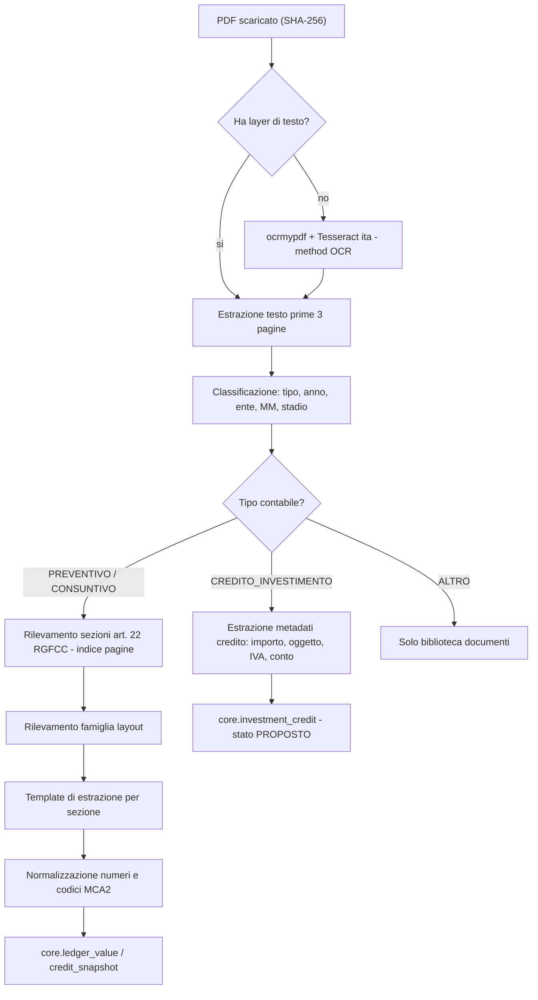

# 06 · Classificazione & Estrazione PDF (Stadio 2–3)

## 1. Pipeline per documento



## 2. Classificazione (FR-004)

### 2.1 Regole su titolo/URL (prima passata)

| Pattern (case-insensitive, accent-insensitive) | Esito |
|---|---|
| `preventiv[oi]` + anno `20\d{2}` | `PREVENTIVO`, `fiscal_year` = anno |
| `consuntiv[oi]` \| `conto consuntivo` \| `bilancio consuntivo` | `CONSUNTIVO` |
| `piano (economico[- ])?finanziario` + `20\d{2}\s*[-–]\s*20\d{2}` | `PIANO_FINANZIARIO` |
| `credito` \| `richiesta di credito` \| `credito quadro` | `CREDITO_INVESTIMENTO` (+ sottotipo) |
| `suppletori[oa]` / `a posteriori` / `revoca` / `liquidazione` | sottotipi |
| `rapporto (della )?commissione` \| `Rapporto-CG` | `RAPPORTO_COMMISSIONE` |
| `AAP` \| `ACAP` \| `acqua potabile` / `azienda elettrica` \| `AE` / `porto` \| `APONA` / `casa anziani` \| `San Carlo` | `entity` |
| `naturalizzazion` \| `attinenza comunale` \| `esproprio` | `contains_personal_data = true` |
| `emendat` \| `dopo emendamenti` \| `approvati CC` | `budget_stage` |

### 2.2 Verifica sul contenuto (seconda passata)
- Header di sistema: `Comune di <NOME>` + `MCA2` + timestamp `dd.mm.yyyy hh:mm:ss` + `Pagina X di Y`.
- Intestazioni colonne: `Preventivo 2027 | Preventivo 2026 | Consuntivo 2025` → conferma anno e `column_role`.
- Confidenza = media pesata (titolo 0.4, contenuto 0.6). **< 0.85 → `NEEDS_REVIEW`**.

## 3. Sezioni da estrarre (per fase)

| Sezione (art. 22 RGFCC) | Contenuto | Fase | Tabella target |
|---|---|---|---|
| lett. a — Riassunto generale | CE a 3 stadi, CI, conto di finanziamento, bilancio | **MVP** | `ledger_value` (`RIASSUNTO`) |
| lett. c — Ricapitolazione per genere (4 cifre) | Totali per natura 2/3/4 cifre | **MVP** | `ledger_value` (`NATURA`) |
| lett. d — Ricapitolazione per dicasteri | Totali funzionali 0–9 | **MVP** | `ledger_value` (`FUNZIONE`) |
| lett. f — Controllo crediti d'investimento | 9 colonne standard | **MVP** | `credit_snapshot` |
| lett. o — Analisi finanziaria (indicatori) | valori ufficiali | **MVP** | `indicator_value` (`REPORTED`) |
| lett. b — Dettaglio CE/CI/Bilancio | ogni conto | Fase 2 | `ledger_value` (`DETTAGLIO`) |
| lett. e — Tabella cespiti | beni amministrativi | Fase 2 | `asset_snapshot` |
| lett. l — Flussi di mezzi liquidi | metodo indiretto | Fase 2 | `ledger_value` |
| lett. g/h/m — debiti, accantonamenti, debitori d'imposta | — | Fase 3 | da definire |

### Rilevamento sezioni
Indice pagine costruito cercando i titoli canonici (con sinonimi in `registry/glossario.yaml`): `Riassunto generale`, `Ricapitolazione per genere di conto`, `Ricapitolazione per dicastero`, `Controllo dei crediti`, `Tabella dei cespiti`, `Analisi finanziaria`, `Indicatori finanziari`.

## 4. Famiglie di layout e template

Un **template** = file YAML in `registry/layouts/<famiglia>/<sezione>.yaml`:

```yaml
family: GECOTI_V3
section: RICAP_NATURA
detect:
  header_regex: "Comune di .+ MCA2"
  column_headers: ["Preventivo", "Consuntivo"]
columns:            # posizioni x relative (0..1), ricalibrate per pagina con le intestazioni
  - { name: code,  x: [0.00, 0.08] }
  - { name: label, x: [0.08, 0.40] }
  - { name: cur_spesa,  x: [0.40, 0.50] }
  - { name: cur_ricavo, x: [0.50, 0.60] }
  - { name: p1_spesa,   x: [0.60, 0.70] }
  - { name: p1_ricavo,  x: [0.70, 0.80] }
  - { name: p2_spesa,   x: [0.80, 0.90] }
  - { name: p2_ricavo,  x: [0.90, 1.00] }
row_rules:
  code_regex: "^(\\d{1,4})(\\.\\d{3})?$"
  continuation: "riga senza codice e senza importi => concatena alla label precedente"
  skip_regex: "^(Totale|Riporto|Pagina)"
```

Famiglie iniziali previste: `GECOTI_V3`, `CRYSTAL_REPORTS`, `GENERIC_GRID` (fallback euristico basato su `pdfplumber.extract_table` + allineamento colonne). Ogni nuova famiglia = nuovo template + almeno 2 PDF nel golden set.

## 5. Normalizzazione numerica ticinese (FR-012)

Funzione pura `parse_chf(raw: str) -> Decimal | None` — **test obbligatori**:

| Input grezzo | Output |
|---|---|
| `15'432'147.41` | `15432147.41` |
| `15’432’147.41` (apostrofo tipografico) | `15432147.41` |
| `1'200.--` | `1200.00` |
| `1'200.-` | `1200.00` |
| `./. 35'000` | `-35000.00` |
| `(12'345.60)` | `-12345.60` |
| `12'345.60-` | `-12345.60` |
| `-` / `—` / vuoto | `None` (non zero!) |
| `0.00` | `0.00` |
| `1 234 567.80` (spazio sottile U+202F) | `1234567.80` |
| `CHF 81'000.00` | `81000.00` |
| `8,1%` | errore: non è un importo CHF → gestito da `parse_pct` |

> ⚠️ **Nessun arrotondamento a 0.05 CHF**: la contabilità pubblica MCA2 è al centesimo. (La regola 0.05 del progetto Corfin **non** si applica qui.)

Codici: `615.5010.011` → `function_code=615`, `account_code=5010`, `detail_code=011`; `3010.100` (vista per natura) → `account_code=3010`, `detail_code=100`.

## 6. Estrazione documenti di credito (MM di richiesta)

Campi: oggetto, importo richiesto (lordo), IVA inclusa/esclusa, quota netta Comune, sussidi attesi, conto d'investimento previsto, data seduta CC (se disponibile), esito (dal verbale/risoluzione, fase 2).
Metodo: regex su dispositivo di risoluzione (`è concesso un credito di CHF …`, `è approvato`) + revisione obbligatoria del curatore.

## 7. Uso di LLM (controllato)

| Consentito | Vietato |
|---|---|
| Suggerire classificazione con bassa confidenza | Pubblicare valori estratti da LLM senza revisione |
| Proporre mapping di una label non riconosciuta a un conto MCA2 | Inventare valori mancanti |
| Riassumere un MM nella biblioteca (marcato "riassunto automatico") | Inviare PDF con dati personali a servizi esterni |

Ogni output LLM salva `method = LLM_ASSISTED`, modello, prompt hash e richiede `APPROVE` del curatore.

## 8. Golden set (qualità)

- 25 PDF selezionati per coprire: ≥ 1 per famiglia CMS, ≥ 3 famiglie di layout, preventivo + consuntivo, fascicolo unico + sdoppiato, almeno 1 scansionato, almeno 1 con aziende.
- Per ciascuno: `expected/<sha256>.json` annotato a mano (Riassunto + 20 righe natura + 20 dicasteri + tutto l'Allegato f).
- Metriche in CI: **precision/recall per cella**, errore assoluto = 0 sui totali; regressione bloccante.
- Primi candidati (dal report): Losone MM 060 (Cons. 2025), Tenero-Contra MM 7/2026, Brione MM 566 (Prev. 2027), Terre di Pedemonte Cons. 2025, Mergoscia MM 08-2026, Minusio MM 2026/37, Cugnasco-Gerra MM 33, Ronco s/A Prev. 2026 (WordPress), Lavertezzo MM 2026-07 (Joomla).
