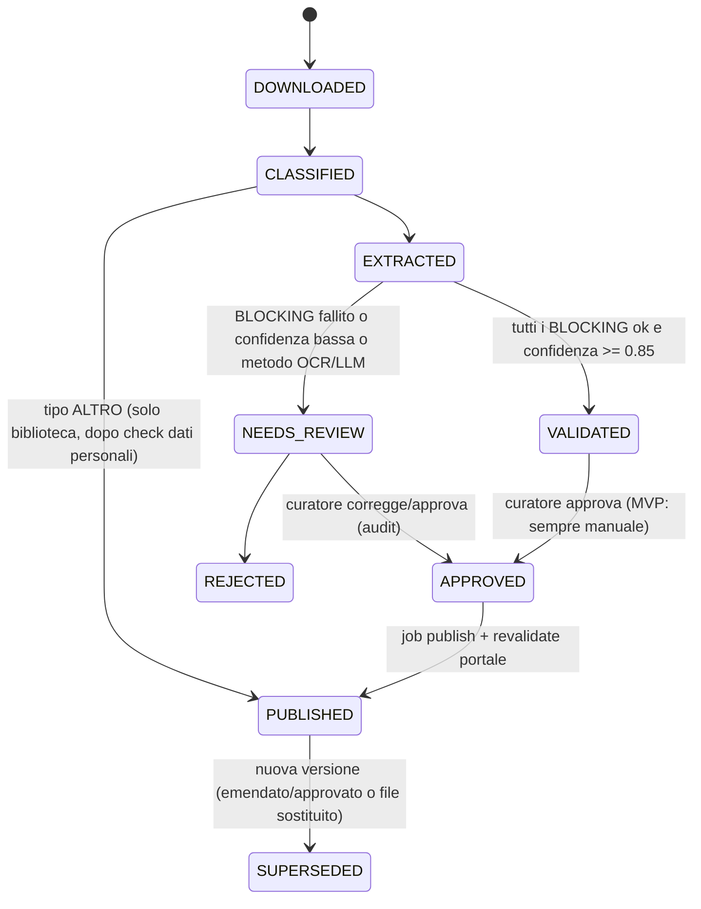

# 07 · Motore di Validazione & Indicatori (Stadio 4)

## 1. Macchina a stati del documento

> **MVP**: anche i documenti `VALIDATED` passano da approvazione manuale (fiducia da costruire). Dopo 2 cicli senza errori → auto-approvazione per famiglie di layout stabili.

## 2. Controlli (FR-020)

Tolleranze di default: `TOL_ROW = 1.00 CHF`, `TOL_TOTAL = max(1.00 CHF, 0.0001 × |totale|)`.

| Codice | Controllo | Formula | Severità |
|---|---|---|---|
| **V01** | Quadratura interna somme | Σ righe 4 cifre = subtotale 3 cifre = subtotale 2 cifre = totale (per natura e per funzione) | BLOCKING |
| **V02** | Coerenza natura ↔ funzione | Totale spese CE per natura = totale spese CE per dicasteri (idem ricavi, CI) | BLOCKING |
| **V03** | CE a 3 stadi (art. 156 cpv. 2 LOC) | Ris. operativo = (40+41+42+43+45+46) − (30+31+33+35+36+37); Ris. finanziario = 44 − 34; Ris. straordinario = 48 − 38; Totale = somma | BLOCKING |
| **V04** | Imputazioni interne | Totale gruppo 39 = totale gruppo 49 | BLOCKING |
| **V05** | Finanziamenti speciali | Per 710/720/730 (+ FER): versamenti 35 − prelievi 45 = Δ fondo 29xx a bilancio | WARNING |
| **V06** | Conto investimenti | Onere netto = uscite (5x) − entrate (6x); coerente con Riassunto | BLOCKING |
| **V07** | Conto di finanziamento | Autofinanziamento = risultato + 33 + 35 − 45 + 364/365 + 366 ± 389/489 (secondo schema del Riassunto); Risultato di finanziamento = Autofinanziamento − Onere netto investimenti | BLOCKING |
| **V08** | Ponte BA (Fase 2) | BA 01.01 + onere netto investimenti BA − ammortamenti (33 + 366) ± rettifiche = BA 31.12 (bilancio) = Σ cespiti 31.12 | WARNING |
| **V09** | Bilancio | Totale attivi = totale passivi; capitale proprio 29 variato del risultato d'esercizio (± movimenti 389/489) | BLOCKING |
| **V10** | Allegato f riga | `spent_total = used_at_0101 + spent_year` e `residual = amount_voted − spent_total` | BLOCKING (per riga) |
| **V11** | Continuità crediti tra anni | `used_at_0101(T) = spent_total(T−1)` per stesso credito | WARNING |
| **V12** | Indicatori reported vs computed | `|reported − computed| ≤ 0.5 punti %` (o 50 CHF pro capite) | WARNING (pubblico) |

### Segnalazioni di contenuto (non errori di estrazione — sono *notizie*)
| Codice | Segnale | Regola |
|---|---|---|
| S01 | Sorpasso credito | `residual < 0` → badge pubblico "Sorpasso" con % |
| S02 | Spesa d'investimento senza credito formale | spesa su conto CI non presente in Allegato f e > soglia delega del Regolamento comunale |
| S03 | Indicatore oltre soglia SEL "eccessiva/debole" | da `ref.indicator_scale` |
| S04 | Scostamento Cons/Prev rilevante | `|Δ risultato| > 5% dei ricavi operativi` |

> ⚠️ **S02 è delicato** (potenziale accusa di irregolarità): pubblicato solo dopo revisione del curatore e con formulazione neutra ("spesa senza credito individuato negli allegati").

## 3. Gli 8 indicatori SEL (art. 22 lett. o RGFCC)

| Codice | Indicatore | Formula (input da `ledger_golden`) | Scala proposta (DA VERIFICARE sul Manuale MCA2) |
|---|---|---|---|
| `NET_DEBT_RATIO` | Tasso di indebitamento netto | Debito pubblico netto / Gettito fiscale | <100% buono · 100–150% accettabile · >150% eccessivo |
| `SELF_FIN_DEGREE` | Grado di autofinanziamento | Autofinanziamento / Investimenti netti BA | >100% buono · 80–100% (o 70–100%) normale · <80% (o <70%) debole — **C-03h** |
| `INTEREST_SHARE` | Quota interessi | Interessi netti / Ricavi correnti | 0–4% buono · 4–9% sufficiente · ≥9%(?)–10% eccessivo — **C-03g** |
| `NET_DEBT_PC` | Debito pubblico netto pro capite | Debito netto / Popolazione | <1'000 basso · 1'000–3'000 medio · 3'000–5'000 elevato · >5'000 eccessivo |
| `INVEST_SHARE` | Quota investimenti | Investimenti lordi BA / Uscite consolidate | <10% ridotta · 10–20% media · 20–30% elevata · >30% molto elevata |
| `EQUITY_SHARE` | Quota capitale proprio | Capitale proprio / Totale passivi | <10% debole · 10–20% media · 20–40% buona · >40% eccessiva |
| `DEBT_SERVICE_SHARE` | Quota oneri finanziari | (Interessi netti + Ammortamenti) / Ricavi correnti | <5% debole · 5–15% sopportabile · >15% alto |
| `SELF_FIN_CAPACITY` | Capacità di autofinanziamento | Autofinanziamento / Ricavi correnti | >20% buona · 10–20% media · <10% debole |

**Definizioni operative da fissare con il Manuale MCA2** (task di Fase 0): "debito pubblico netto" (capitale dei terzi − beni patrimoniali?), "ricavi correnti", "uscite consolidate", "gettito fiscale" (gettito d'imposta comunale vs imposta cantonale base). Ogni definizione → riga in `ref.indicator_def.formula_text` con citazione del capitolo.

## 4. Implementazione

- Ogni regola = funzione pura `check_vXX(ctx: DocumentContext) -> list[ValidationResult]`, testata con fixture del golden set.
- Registro regole in `validate/registry.py` con metadati (codice, severità, fase, descrizione IT pubblica).
- Pagina pubblica **/metodologia** generata dal registro (stesse descrizioni) → trasparenza totale sui controlli.
