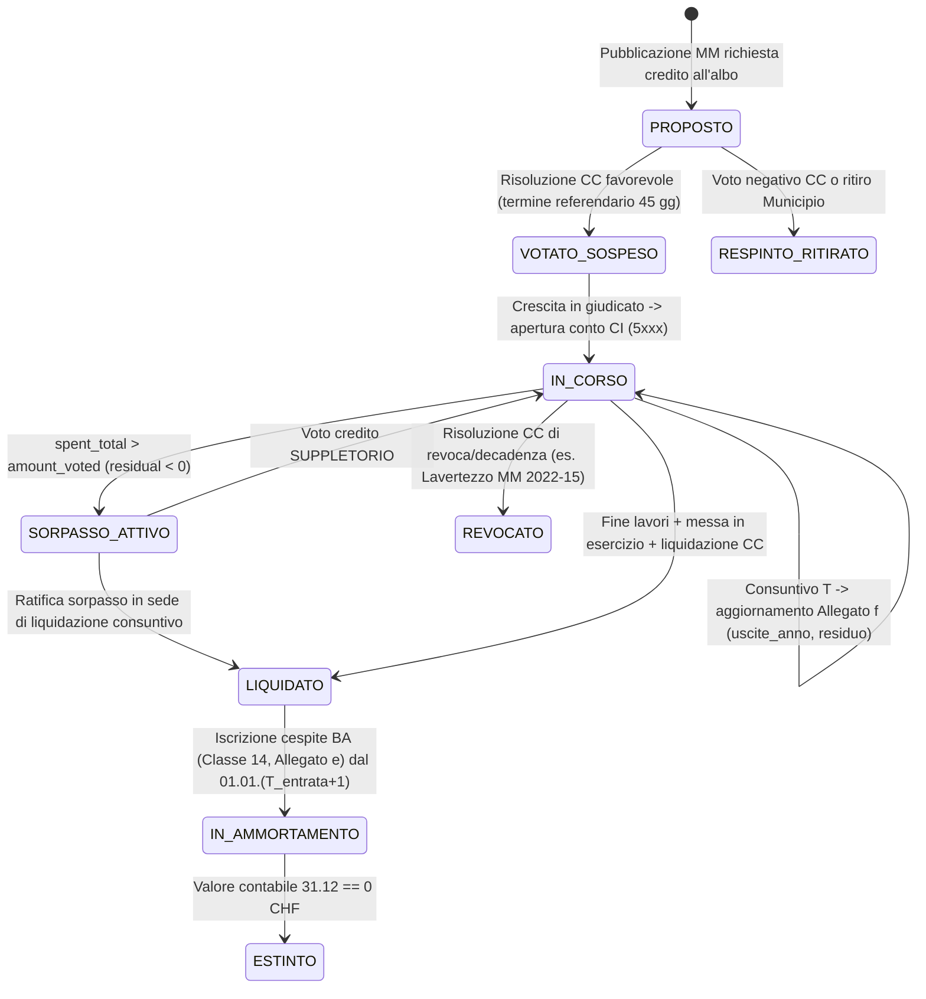

# 08 · Ciclo di Vita Crediti d'Investimento (Allegato f) & Cespiti BA (Allegato e)

## 1. Quadro normativo ticinese (LOC & RGFCC)

Nel modello MCA2 ticinese (art. 15, 17 e 22 RGFCC; art. 13, 42 e 75 LOC), il **Preventivo del Conto degli investimenti (CI)** ha valore esclusivamente **programmatico e finanziario**: la sua approvazione annuale **non** autorizza il Municipio a spendere. L'autorizzazione giuridica nasce solo da uno dei seguenti atti:

| Tipo autorizzazione (`authorization`) | Organo competente | Base legale | Comportamento in pipeline |
|---|---|---|---|
| `CC_ORDINARIO` | Consiglio comunale (soggetto a referendum 45 gg ex art. 75 LOC) | Art. 13 cpv. 1 lett. e LOC | Credito puntuale legato a `MM XX/YYYY`; entra in Allegato f dall'anno del voto |
| `CREDITO_QUADRO` | Consiglio comunale | Art. 15a RGFCC (es. Locarno MM 42 manutenzione strade 2027–2030; Ascona AE cabine MT/BT) | Un credito padre suddiviso internamente dal Municipio in lotti esecutivi; controllo sul plafond complessivo |
| `DELEGA_MUNICIPIO` | Municipio | Regolamento comunale (es. Losone max 70'000 CHF per opera) | Non ha un MM dedicato; appare a consuntivo nel CI o in elenco deleghe; tracciato per verificare mancato frazionamento artificioso |
| `SUPPLETORIO` | Consiglio comunale | Art. 15 RGFCC (quando in corso d'opera il credito iniziale risulta insufficiente) | Incrementa `amount_voted` del credito originario mantenendo il legame storico (`parent_credit_id`) |
| `A_POSTERIORE` | Consiglio comunale | Opere urgenti/imprevedibili (es. Locarno MM 15 grandinata 25.08.2023 da 9.75 mio CHF; Lavertezzo Valegia) | Spesa già sostenuta o avviata d'urgenza e sottoposta a ratifica formale |

---

## 2. Macchina a stati end-to-end (dal voto all'ammortamento)

---

## 3. Anatomia dell'Allegato f e regole di riconciliazione

Ogni riga estratta dalla **Tabella del controllo dei crediti d'investimento** (art. 22 cpv. 1 lett. f RGFCC) popola `core.credit_snapshot` con 9 attributi canonici:

1. `account_full` — codice funzionale + natura + progressivo (es. `615.5010.011` Strade comunali, `720.5290.013` Canalizzazioni).
2. `account_label` — denominazione del conto MCA2.
3. `credit_label_raw` — testo del riferimento delibera + descrizione opera (es. `MM 06/2023 Manutenzione strade 2023-2025`).
4. `vote_date` — data risoluzione Consiglio comunale (`dd.mm.yyyy`).
5. `used_at_0101` — spesa cumulata lorda al 1° gennaio dell'anno `T`.
6. `spent_year` — spesa lorda contabilizzata nel Conto Investimenti nell'anno `T`.
7. `spent_total` — spesa cumulata al 31 dicembre `T` (`used_at_0101 + spent_year`).
8. `amount_voted` — credito lordo autorizzato dal CC (comprensivo di eventuali crediti suppletori già votati).
9. `residual` — differenza `amount_voted - spent_total` (`> 0` residuo disponibile; `< 0` **sorpasso di spesa**).

### 3.1 Gestione Lordo vs Netto, Sussidi e IVA (Principio dell'universalità)
- **Regola contabile MCA2**: il credito votato e controllato nell'Allegato f è espresso **al lordo** (principio del prodotto lordo: le spese su classe `5xxx` non vanno compensate con i sussidi/contributi incassati su classe `6xxx`, es. rimborsi cantonali PALoc o contributi LIA/FER).
- **Caso particolare IVA**: dal 1° gennaio 2024 l'aliquota ordinaria svizzera è passata dal **7.7% all'8.1%**. Per l'amministrazione generale l'IVA non recuperabile fa parte del costo lordo d'opera; per i **servizi assoggettati IVA** (Azienda Acqua Potabile, Azienda Elettrica, Depurazione/Rifiuti se optati) i crediti possono essere espressi **IVA esclusa**. Il campo `core.investment_credit.vat_included` traccia esplicitamente il regime per evitare falsi scostamenti.
- **Investimento netto a carico del Comune (`net_expected`)**: estratto dal testo del Messaggio Municipale (es. Locarno MM 15 grandinata: credito lordo `9'750'000 CHF`, sussidi/assicurazioni `7'742'376 CHF`, onere netto Città `2'007'624 CHF`). Il portale mostra **entrambi** i valori per non indurre in errore il cittadino sull'impatto effettivo sul debito pubblico.

---

## 4. Algoritmo di Entity Resolution (collegamento MM ↔ Allegato f multi-anno)

Poiché la stringa `credit_label_raw` varia leggermente da un anno all'altro nei tabulati comunali (es. `MM 6/23`, `MM 06/2023`, `MM no. 6 del 2023`), la pipeline collega gli snapshot annuali all'entità stabile `core.investment_credit` tramite una cascata deterministica a 4 livelli:

1. **Livello 1 (Chiave forte esatta — confidenza 1.00)**: `(ust_code, entity_id, account_full, canonical_mm(mm_number), vote_date)` coincidono.
   - `canonical_mm("MM no. 06-2023")` → `"2023/006"` (quando il comune numera per anno) oppure `"SEQ/1575"` (quando numera progressivamente per legislatura/storia, es. Brissago MM 1575, Gordola MM 1506, Brione MM 566, Gambarogno MM 470, Centovalli MM 294).
   - Il tipo di numerazione (`YEARLY_RESET` vs `SEQUENTIAL`) è configurato per ciascun Comune in `registry/comuni.yaml`!
2. **Livello 2 (Continuità contabile — confidenza 0.95)**: stesso `(ust_code, entity_id, account_full)` e `|used_at_0101(T) - spent_total(T-1)| <= 1.00 CHF`.
3. **Livello 3 (Match fuzzy controllato — confidenza 0.75..0.89)**: stesso `ust_code` + `vote_date` identica + similarità token Jaccard ≥ 0.70 su `title` → inviato in **coda curatore** per conferma link (`NEEDS_REVIEW`).
4. **Livello 4 (Nuovo credito)**: nessun match → crea nuovo `core.investment_credit` (e verifica se esiste già un MM in biblioteca con stesso `canonical_mm`).

---

## 5. Passaggio ad Allegato e (Tabella dei Cespiti BA — Classe 14)

Quando un'opera entra in esercizio e viene liquidata:
1. Il costo netto d'acquisizione confluisce nei **Beni Amministrativi (classe 14)**:
   - `1400` Terreni BA · `1401` Opere del genio civile (strade, ponti, argini) · `1402` Opere idrauliche/canalizzazioni · `1403` Edifici (scuole, palestre, case comunali) · `1406` Mobili, macchine, veicoli · `1420` Immobilizzazioni immateriali (Piani regolatori, PGS, PGA, GIS).
2. **Inizio ammortamento (art. 17 RGFCC)**: l'ammortamento lineare sul valore di acquisizione netto inizia **dall'esercizio successivo all'entrata in funzione dell'opera** (non durante il cantiere!), applicando le aliquote degli **Allegati 1 e 2 RGFCC** (es. edifici 3–4% = 25–33 anni; strade/sottostrutture 2.5–5%; canalizzazioni/acquedotti 1.25–2.5% = 40–80 anni; informatica/veicoli 10–25%).
3. **Impatto strutturale monitorato da OFCL ("Onda d'urto ammortamenti")**: il portale calcola e visualizza per ogni Comune gli **ammortamenti futuri impliciti** generati dai grandi cantieri in corso (es. Palestra multiuso Terre di Pedemonte → +250'000 CHF/anno sul conto `3300`; polo scolastico/edilizio Losone → balzo ammortamenti da 1.20 mio a 2.24 mio CHF/anno entro il 2028), spiegando al cittadino perché il Conto Economico può andare in disavanzo contabile pur con autofinanziamento positivo.
