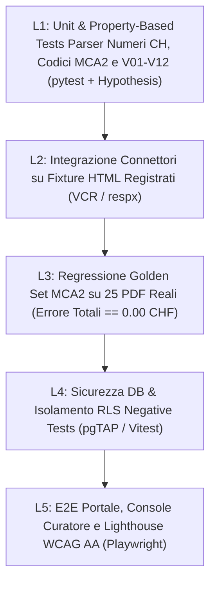

# 11 · Strategia di Testing, Golden Set MCA2 & Verifica SDD

> In conformità al ruolo **QA & SDD Verifier (`AGENTS.md`)**: nessuna task in `14-tasks-build-roadmap.md` può essere marcata `[x]` senza evidenza di test automatico verde o verifica documentata sul Golden Set.

---

## 1. Piramide di Verifica del Sistema

---

## 2. Specifiche per Livello di Test

### L1 · Unit & Property-Based Testing (`pipeline/tests/unit/`)
- **Parser numerico elvetico (`parse_chf`)**: oltre ai 12 casi canonici (`15'432'147.41`, `1'200.--`, `./. 35'000`, `(12'345.60)`, spazi sottili Unicode `U+202F`, trattini nulli `-`), `Hypothesis` genera 5'000 importi casuali `Decimal` nell'intervallo `[-999_999_999.99, +999_999_999.99]`, li formatta nelle 6 varianti tipografiche ticinesi e verifica l'invariante `parse_chf(format_ch(d)) == d` al centesimo esatto (`0.01 CHF`).
- **Motore di validazione (`V01`–`V12`)**: per ogni regola, almeno **1 fixture positiva** (quadratura esatta), **1 fixture dentro tolleranza** (`0.50 CHF` per arrotondamenti tabulari) e **2 fixture negative** (sbilancio `BLOCKING` che impedisce la transizione a `VALIDATED`).
- **Calcolatore 8 Indicatori SEL**: test parametrici su casi limite (`Investimenti netti BA == 0` o `< 0` per incasso sussidi straordinari → divisione per zero gestita con stato `N/A_NET_SURPLUS`, mai crash o `Infinity`).

### L2 · Test Connettori Deterministici Offline (`pipeline/tests/connectors/`)
- **Zero chiamate live in CI**: le risposte HTML/JSON reali dei 5 archetipi CMS (Assolo moderno, Assolo legacy firmato `&rif=` di Orselina, WordPress REST/HTML, Joomla jDownloads di Lavertezzo, Custom Città di Locarno) vengono salvate come snapshot anonimizzati in `tests/fixtures/html/`.
- **Test obbligatorio `robots.txt` Gate**: un test dedicato inietta il `robots.txt` reale di Locarno (`Disallow: /files/`) e di Lavertezzo (`Disallow: /images/PDF/`) e verifica che `Downloader.fetch()` sollevi `RobotsDisallowedError` con **0 byte scaricati**.

### L3 · Golden Set MCA2 (25 PDF Reali Annotati — `pipeline/tests/golden/`)
Il banco di prova decisivo per domare la criticità **C-05**:
- **Composizione minima (25 documenti)**:
  - 13 da Comuni Assolo (inclusi fascicoli unici come Brione MM 566 e sdoppiati come Losone, Ascona, Tenero-Contra, Terre di Pedemonte).
  - 3 da WordPress (Brissago, Centovalli, Ronco s/Ascona inclusi conti emendati CC).
  - 2 da Joomla Lavertezzo (incluso 1 tabulato *Seagate Crystal Reports* storico per testare layout non-Ge.Co.Ti.).
  - 2 da Città di Locarno (acquisiti manualmente per testare fascicoli multi-ente Città + LEA + San Carlo da >9 MB).
  - 2 da aziende municipalizzate separate (es. AAP Terre di Pedemonte, Azienda Elettrica Ascona).
  - 2 PDF scansionati/degradati per il ramo OCR (`ocrmypdf` + `tesseract-ocr-ita`).
  - 1 Messaggio di credito complesso con sussidi PALoc / grandinata.
- **Soglie bloccanti in CI**:
  - **100.0%** di esattezza (`delta == 0.00 CHF`) su tutti i subtotali del **Riassunto Generale** (Risultato operativo, ordinario, totale, Onere netto investimenti, Autofinanziamento, Capitale proprio, Debito netto).
  - **≥ 98.5%** cell-level accuracy sulle righe di Ricapitolazione per natura (lett. c), per dicasteri (lett. d) e Controllo crediti (lett. f); qualsiasi errore residuo **deve** essere intercettato automaticamente da `V01` o `V10` mandando il documento in `NEEDS_REVIEW` (**0 falsi positivi silenziosi ammessi**).

### L4 · Sicurezza Database & RLS Negative Suite (`supabase/tests/`)
Verifica formale delle policy Row Level Security su istanza locale Supabase:
1. Ruolo `anon`:
   - `SELECT` su `raw.*`, `core.*`, `audit.*` → **PERMESSO NEGATO / 0 righe**.
   - `SELECT` su `api.*` → restituisce **esclusivamente** righe legate a `document_version.status = 'PUBLISHED'` e `raw.document.contains_personal_data = false`.
   - Qualsiasi `INSERT / UPDATE / DELETE` su qualunque schema → **PERMESSO NEGATO**.
2. Ruolo `authenticated` normale (senza `app_metadata.role == 'curator'`) → identico ad `anon` (impedisce privilege escalation registrandosi via Supabase Auth).
3. Ruolo `curator`: ogni correzione su `core.ledger_value` senza riga corrispondente in `audit.curator_action` (con `reason` ≥ 10 caratteri) fallisce via trigger transazionale.
4. Sicurezza `audit.feedback_ticket` & `api.municipal_civic_guide`: `anon` non può leggere né inserire direttamente in `audit.feedback_ticket` via PostgREST (scrittura riservata a `POST /api/feedback` con `service_role`); `api.municipal_civic_guide` espone esclusivamente voci con `verified_at is not null` e `source_url` valido.

### L5 · E2E Portale, Split-View Curatore & Accessibilità (`web/e2e/`)
Suite Playwright su 7 flussi critici:
1. **Regola dei 30 secondi (US1)**: navigazione `/` → `/comuni/losone` → apertura popover fonte su KPI → verifica URL PDF `#page=N`.
2. **Doppia Pipeline Responsiva (Desktop vs Mobile)**: verifica viewport Desktop `1440×900` (`DashboardDesktop` master-detail reattivo in-place senza reload + cruscotto 8 micro-tacche SEL) e viewport Mobile `390×844` (`DashboardMobile` apertura Bottom Sheet scorrevole + verifica tap target ≥ `44px` e `CLS == 0.00`).
3. **Comparatore & Export CSV (US2)**: selezione 5 Comuni su `NET_DEBT_PC` → ordinamento → download CSV → verifica corrispondenza esatta numeri UI vs CSV.
4. **Filtro Sorpassi Crediti (US3)**: apertura `/crediti?only_overruns=true` → verifica badge rosso + icona testuale + dettaglio storico multi-anno.
5. **Civic Deep Dive & Civic Ticket Sandbox (US9, US10)**: apertura tab Tasse/Sussidi con verifica link ordinanza `source_url`; invio segnalazione su `/api/feedback` → test sanitizzazione payload ``, blocco > 500 caratteri e HTTP `429` alla 4ª richiesta dalla stessa origine.
6. **Workflow Curatore completo (US6)**: login curatore → apertura documento `NEEDS_REVIEW` con `V10` fallito → rettifica cifra con motivazione → riesecuzione `V10` verde → `APPROVE` → `PUBLISH` → verifica comparsa immediata sulla vista pubblica.
7. **Audit automatico `@axe-core/playwright`**: **0 violazioni WCAG 2.1 AA** su tutte le pagine pubbliche (desktop, mobile `375×812` e modalità `prefers-reduced-transparency: reduce`).
