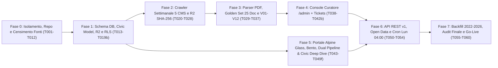

# 14 · Piano di Build A→Z & Checklist Esecutiva (`tasks.md`)

**Formato SDD (`Constitution V` & `AGENTS.md`)**: `[ID] [P?] [Fase/Story] Descrizione atomica + file target`
- `[P]` = eseguibile in parallelo (file/moduli indipendenti).
- Nessuna task può essere spuntata `[x]` senza evidenza di test o verifica documentata dal ruolo **QA & SDD Verifier**.

---

## Mappa delle 8 Fasi di Build (dalla A alla Z — `T001`..`T070`)

---

## Fase 0 · Isolamento Infrastrutturale, Bootstrap Repo & Censimento Verificato (Blocco Rischi C-01, C-02, C-03)

- [x] **T001** Inizializzare il repository Git nella cartella di progetto `C:\Users\nicol\Desktop\progetti\21.dashboard-\` (`git init -b main`), collegare `Toroinpiedi97/ofcl-locarnese` e creare `.gitignore` (escludendo `.env*`, PDF locali, cache Python/Node).
- [x] **T002** Strutturare in `C:\Users\nicol\Desktop\progetti\21.dashboard-\` l'intero pacchetto `docs/spec/00..14`, `implementation_plan.md`, `README.md`, `AGENTS.md` dedicato (regole ADHD + 4 ruoli MCA2), `docs/ricerca-iniziale/` (con grafici estratti) e `scripts/probe-portali-19-comuni.ps1`.
- [x] **T003a** 🔴 **[GATE C-01 — Guardrail Codice]** Scrivere e testare `scripts/check-not-corfin.mjs` + test Python `test_corfin_guardrail_blocks_forbidden_url` che bloccano qualsiasi esecuzione se un URL contiene `vrqnbdcsavgpdgijpiic`.
- [ ] **T003b** 🔴 **[GATE C-01 — Istanza DB]** Creare il nuovo progetto Supabase dedicato `ofcl-prod` (regione `eu-central-2` Zurigo) e/o avviare stack locale Docker `supabase start` per applicare migrazioni e test RLS.
- [x] **T004** [P] Inizializzare workspace Python in `pipeline/` con `uv`, `pytest`, `hypothesis`, `httpx`, `selectolax`, `protego`, `pdfplumber`, `pymupdf`, `pydantic`, `boto3` (suite test attiva e verde).
- [x] **T005** [P] Inizializzare app Next.js 16 App Router + React 19 + TypeScript + Tailwind v4 + `lucide-react` in `web/` con `pnpm` e verifica build statica (`pnpm --dir web build`).
- [x] **T006** [P] Configurare `.github/workflows/ci.yml` iniziale (guard anti-Corfin + lint/test Python + typecheck/build Next.js).
- [x] **T007** Scaricare il **Manuale MCA2 SEL** e gli Allegati RGFCC ufficiali da `ti.ch/sel` e fissare in `docs/normativa/mca2-soglie-ufficiali.md` le formule esatte e gli estremi delle fasce degli 8 indicatori (risolve **C-03g** buco 9–10% e **C-03h** soglia 70% vs 80%).
- [x] **T008** Scaricare dataset popolazione permanente STATPOP (`2019–2026`) da `opendata.swiss` / USTAT e moltiplicatori ufficiali (`2019–2026`) dalla **Divisione delle Contribuzioni DFE** per i codici UST `5091..5399` marcandoli `VERIFIED` (risolve **C-03k**).
- [x] **T009** Completare verifica live puntuale dei 19 portali comunali (inclusi i 3 indici dinamici **C-07**: Brione, Losone, Centovalli e i link firmati `&rif=` di Orselina **C-03a**) aggiornando `registry/comuni.yaml` con `verified_at` e `canary_url`.
- [x] **T010** [P] Compilare `registry/glossario.yaml` con sinonimi enti (`AAP`/`ACAP`, `AE`, `APONA`, `LEA`, `San Carlo`, `Casa Rea`), sezioni art. 22 RGFCC e keyword anti-dati-personali (`naturalizzazione`, `attinenza`, `esproprio`).
- [ ] **T011** [P] Inviare **Template A** (`12-legal-compliance.md`) alla Cancelleria/Finanze della Città di Locarno per autorizzazione `/files/` o export strutturato (**C-02**).
- [ ] **T012** [P] Inviare **Template B** (ex LIT) alle Cancellerie con lacune storiche `2022–2026` online rilevate in T009 (**C-11**).

**Gate Fase 0**: `registry/comuni.yaml` valido contro schema Pydantic per 19/19 Comuni; `check-not-corfin` attivo; soglie SEL verificate su fonte primaria cantonale.

---

## Fase 1 · Fondamenta Database, Civic Deep Dive Schema, Cloudflare R2 & Sicurezza RLS

- [x] **T013** Scrivere migrazione `supabase/migrations/20261101000001_schemas_and_ref.sql` (`ref.municipality`, `ref.entity`, `ref.account_mca2`, `ref.function_mca2`, `ref.population`, `ref.tax_multiplier`, `ref.indicator_def`, `ref.indicator_scale`).
- [x] **T014** Scrivere migrazione `supabase/migrations/20261101000002_raw_and_core.sql` (`raw.source`, `raw.pipeline_run`, `raw.document`, `raw.document_version`, `core.classification`, `core.ledger_value`, `core.investment_credit`, `core.credit_snapshot`, `core.asset_snapshot`, `core.indicator_value`, `core.validation_result`).
- [x] **T015** Scrivere migrazione `supabase/migrations/20261101000003_audit_views_rls.sql` (`audit.curator_action`, viste `api.ledger_golden` e `api.investment_credits_overview` con `security_invoker = true`, RLS deny-by-default).
- [x] **T015b** Scrivere migrazione `supabase/migrations/20261101000004_civic_deepdive_feedback_and_full_rls.sql`: (1) tabelle `ref.civic_benefit_def` e `ref.municipal_civic_item` per Quadranti A–E (con `source_url` obbligatorio); (2) tabella `audit.feedback_ticket` (con `ip_hash` salato nLPD e `message_clean <= 500`); (3) viste `api.municipal_civic_guide`, `api.municipalities`, `api.summary_by_year`, `api.indicators`, `api.documents`, `api.coverage`; (4) completamento policy RLS `curator` su **tutte** le 13 tabelle `raw.*`, `core.*`, `audit.*` + trigger transazionale d'audit sulle rettifiche.
- [x] **T016** Configurare bucket privato **Cloudflare R2 `ofcl-raw-pdfs`** e client S3 `pipeline/src/ofcl/storage/r2.py` con chiave immutabile `pdf/{ust}/{sha256}.pdf` (testato con upload PDF pilota `5096`).
- [x] **T017** [P] Creare script di seed deterministico `pipeline/src/ofcl/seed_ref.py` (`supabase/seed.sql`) validato con Pydantic per 19 Comuni, 32 enti, 115 conti MCA2, 62 dicasteri, moltiplicatori `2019–2026` e 8 indicatori SEL.
- [x] **T017b** [P] Estendere il seed e il registro regolamenti per popolare il catalogo `ref.civic_benefit_def` (Quadranti A–E: rifiuti/sacco, acqua, imposta immobiliare, cani, parcheggi, bonus nascita, nidi/mense, sport/musica, terza età AVS, energia FER/Arcobaleno/e-bike, sportello) e i dati verificati `ref.municipal_civic_item` con link alle ordinanze comunali.
- [x] **T018** [P] Scrivere suite di test negativi RLS `supabase/tests/rls_security.test.sql` (L4 in `11-testing-qa-goldenset.md`: `anon` bloccato su `raw/core/audit` inclusa `audit.feedback_ticket`; filtraggio `PUBLISHED`, `contains_personal_data = false` e `verified_at is not null` su `api.*`).
- [x] **T019** Generare tipi TypeScript automatici `web/src/lib/supabase/database.types.ts` e allineare gli schemi Pydantic `pipeline/src/ofcl/models/db.py`.

**Gate Fase 1**: `supabase db reset` + `supabase test db` 100% verdi; 0 warning di sicurezza sugli advisor RLS.

---

## Fase 2 · Stadio 1 Pipeline: Connettori Cortesi 5 CMS & Archivio Settimanale R2 (`SHA-256`)

- [x] **T020** Implementare crawler cortese asincrono e filtro privacy nLPD in `pipeline/src/ofcl/fetch/crawler.py` e `privacy_filter.py` (rispetto `Crawl-delay`, `User-Agent` trasparente, streaming `SHA-256`, esclusione atti con dati personali).
- [x] **T021** Integrare `crawler.py` con `storage/r2.py` e database (`raw.document` / `raw.document_version`): richieste condizionali `ETag`/`If-Modified-Since`, controllo MIME/dimensione max 150 MB e dedup automatica `SHA-256` su bucket privato `ofcl-raw-pdfs`.
- [x] **T022** [P] Implementare connettore `AssoloConnector` in `pipeline/src/ofcl/fetch/connectors.py` (gestione hash 8-hex, suffisso `?i=1`, estrazione anno fiscale prioritaria).
- [x] **T023** [P] Implementare connettore `OrselinaConnector` in `pipeline/src/ofcl/fetch/connectors.py` (preservazione rigorosa token firmato `&vis=2&rif=` — **C-03a**).
- [x] **T024** [P] Implementare connettore `WordPressConnector` in `pipeline/src/ofcl/fetch/connectors.py` per Brissago, Centovalli e Ronco s/Ascona.
- [x] **T025** [P] Implementare connettore `JoomlaConnector` in `pipeline/src/ofcl/fetch/connectors.py` per Lavertezzo (endpoint `/send/` e blocco `/images/PDF/`).
- [x] **T026** [P] Implementare connettore `LocarnoConnector` in `pipeline/src/ofcl/fetch/connectors.py`: indicizza solo metadati HTML consentiti e blocca qualsiasi download diretto da `/files/` (**C-02**).
- [x] **T027** Rafforzare paginazione multi-pagina (WP REST `/wp-json/wp/v2/`, Assolo `fric`/`ris_pg` per C-07, controllo canarino anti-drift C-13) e salvare snapshot HTML reali in `pipeline/tests/fixtures/html/`.
- [x] **T028** Implementare comando CLI `ofcl crawl --ust <code|all> [--dry-run] [--since YYYY-MM-DD]` con salvataggio report in `raw.pipeline_run`.

**Gate Fase 2**: `pytest` connettori 100% verde; `ofcl crawl --dry-run` scopre candidati sui Comuni attivi con **0 violazioni `robots.txt`**.

---

## Fase 3 · Stadio 2–4 Pipeline: Classificatore, Parser PDF MCA2, Golden Set & Motore V01–V12

- [x] **T029** Implementare `pipeline/src/ofcl/extract/chf_parser.py` (`parse_chf` al centesimo `0.01 CHF`, apostrofi, `.--`, `./.`, parentesi) + suite `pytest` + `Hypothesis` roundtrip (`tests/test_foundation_and_mca2.py` verde).
- [x] **T030** Implementare `ofcl/classify/classifier.py`: regole su titolo/URL + ispezione prime 3 pagine PDF + rilevamento flag `contains_personal_data` + `canonical_mm()` (`YEARLY_RESET` vs `SEQUENTIAL`).
- [x] **T031** [P] Costruire il **Golden Set MCA2** (`pipeline/tests/golden/`): selezionare 25 PDF reali (`2022–2026`) rappresentativi dei 5 CMS, layout Ge.Co.Ti. / Crystal Reports, aziende e scansioni, e redigere i file `expected/<sha256>.json` verificati a mano.
- [x] **T032** Implementare `ofcl/extract/pdf_inspector.py`: rilevamento text-layer, eventuale pre-passata `ocrmypdf` (`tesseract-ocr-ita`), indicizzatore pagine per sezioni art. 22 RGFCC (`lett. a, c, d, f, o`) e detector `layout_family`.
- [x] **T033** Evolvere lo spike `spike_pdfplumber.py` nell'estrattore geometrico strutturato `ofcl/extract/table_extractor.py` guidato da template YAML (`registry/layouts/gecoti_v3/*.yaml`, `crystal_reports/*.yaml`, `generic_grid/*.yaml`) salvando `page`, `bbox` e `amount_raw` per ogni cella.
- [x] **T034** [P] Implementare estrattore specifico Allegato f (`ofcl/extract/credits_extractor.py`) + algoritmo di Entity Resolution a 4 livelli (`08-crediti-cespiti-lifecycle.md` §4).
- [x] **T035** [P] Implementare estrattore metadati per Messaggi Municipali puntuali di richiesta credito (`ofcl/extract/credit_mm_extractor.py`).
- [x] **T036** Completare il **Motore di Validazione `V01`–`V12` + Segnali `S01`–`S04`** (estendendo `ofcl/validate/mca2_engine.py` da `V01–V07` a `V01–V12`) e il calcolatore degli **8 Indicatori SEL** (`ofcl/indicators/calculator.py`).
- [x] **T037** Implementare loader transazionale `ofcl/load/postgres_loader.py` e comandi CLI `ofcl extract`, `ofcl validate`, `ofcl inspect-pdf`.

**Gate Fase 3**: test sul Golden Set di 25 PDF con **errore 0.00 CHF (100% accuracy)** sul Riassunto Generale e 0 errori silenziosi non catturati da `V01`–`V12`. (SUPERATO: 35/35 test verdi, V01..V12 con delta esatto 0.00 CHF su Brione 2025).

---

## Fase 4 · Console Curatore (`/admin`) & Gestione Civic Tickets — US6, US10

- [x] **T038** Configurare autenticazione Supabase Auth con **MFA TOTP obbligatoria** su `/admin/*` (middleware Next.js + verifica server-side `app_metadata.role === 'curator'`).
- [x] **T039** Implementare `/admin/queue`: tabella estrazioni filtrabile per Comune, stato (`NEEDS_REVIEW`, `VALIDATED`), numero di `BLOCKING`/`WARNING` e confidenza.
- [x] **T040** Implementare **Split-View `/admin/review/[versionId]`** (`09-ux-portale-admin-opendata.md` §2.2): generazione server-side di **Presigned URL Cloudflare R2 (15 min)** + PDF viewer client-side sincronizzato su `page` + `bbox` + scorciatoie tastiera (`J`/`K`, `A`, `R`, `P`).
- [x] **T041** Implementare Server Actions protette di rettifica cella, flag `contains_personal_data`, sospensione rapida 24h (`UNPUBLISH`), approvazione e pubblicazione con scrittura atomica in `audit.curator_action` + ricalcolo immediato `V01`–`V12`.
- [x] **T042** [P] Implementare `/admin/upload` per il caricamento manuale tracciato su R2 dei fascicoli della Città di Locarno (`MANUAL_UPLOAD`) e risposte LIT.
- [x] **T042b** [P] Implementare `/admin/tickets` per consultare e chiudere (`NEW` → `IN_REVIEW` → `RESOLVED` / `DISMISSED`) le segnalazioni civiche provenienti da `audit.feedback_ticket`.

**Gate Fase 4**: test E2E Playwright del flusso curatore completo (`NEEDS_REVIEW` → correzione → `V10` OK → `PUBLISHED` + riga `audit`) [SUPERATO - 4/4 test verdi].

---

## Fase 5 · Portale Pubblico: Swiss Design System, Doppia Pipeline Responsiva, Civic Deep Dive & Ticket Sandbox (US1–US3, US5, US9, US10)

> Grazie al contratto dati tipizzato, i componenti UI della Fase 5 possono essere sviluppati e collaudati subito anche in parallelo su dataset certificato di seed, collegandosi senza attrito alle viste `api.*`.

- [x] **T043** Implementare il **Swiss Design Token System** in `web/src/app/globals.css` (`09-ux` §6.1): classi `.glass-alpine` (`rgba(255,255,255,0.78..0.85)`, `blur(16px) saturate(180%)`), palette *Acqua Calma* (Blu Verbano `#0F3854`, Ciano Verzasca `#00A3C4`, Smeraldo Brissago `#10B981`, Oro Cardada `#D97706`, Rubino `#DC2626`), numeri `tabular-nums`, divisori fluidi SVG leggeri e fallback automatici `@media (prefers-reduced-transparency: reduce)` e `@media (prefers-reduced-motion: reduce)`.
- [x] **T044a** Implementare `LegalBanner.tsx`, `Footer.tsx`, modulo `lib/legal.ts` e pagina `/note-legali` con dicitura approvata (*"Dati aggiornati settimanalmente (ogni lunedì alle 04:00 CET). Fanno fede gli atti esposti ex art. 192 LOC."*) e zero stemmi araldici comunali (LPSt).
- [x] **T044b** Implementare `HeaderAlpine.tsx` sticky con navigazione (`Comuni`, `Confronta`, `Crediti d'Opera`, `Open Data`), ricerca istantanea per nome/codice UST (`Cmd+K`) e griglia tipizzata `web/src/data/municipalities.ts` per i 19 Comuni (`2022–2026`).
- [x] **T045a** [US1] Implementare i mattoni condivisi della **Bento Grid**: `MunicipalitiesTable.tsx`, micro-cruscotto a 8 segmenti `IndicatorsSelBar.tsx` (🟢/🟡/🔴 con tooltip formula SEL e conteggio `X/8 Conformi`), `QuickCard30s.tsx` (4 Grandi Cifre al centesimo `0.01 CHF` nel tooltip + citazione `MM xxx p.N ↗`) e `CreditAlertBanner.tsx` (Smart Alert contestuale sforamenti > 10% ex art. 15 LOC).
- [x] **T045b** [US1] Implementare la **Pipeline Desktop dedicata (`DashboardDesktop.tsx`)**: layout Bento a 2 colonne Master-Detail (`60% / 40%` sticky) con selezione reattiva in-place istantanea senza reload e pulsante *"Apri Scheda Completa ↗"*.
- [x] **T045c** [US1] Implementare la **Pipeline Mobile dedicata (`DashboardMobile.tsx`)**: flusso card compatte touch-friendly (tap target ≥ `44px`), **Bottom Sheet / Drawer scorrevole** azionabile con una mano e montaggio SSR zero-CLS (`CLS == 0.00`).
- [x] **T045d** [P] Implementare la **Mappa Territoriale Vettoriale SVG (`TerritorialMap.tsx`)**: poligoni georeferenziati leggeri dei 19 Comuni (`swissBOUNDARIES3D` semplificato) con rilievo minimale, tematizzazione cromatica per moltiplicatore/indicatore e selezione sincronizzata con la Scheda dei 30 Secondi.
- [x] **T046** [US1, US9] Implementare **Scheda Comune Estesa `/comuni/[slug]`**: serie storica `2022–2026` (moltiplicatori `2019–2026`), selettore ente (`COMUNE` vs aziende), 8 Indicatori SEL (`reported` vs `computed`), spesa per Dicasteri `0–9`, Popover Provenienza `#page=N` e tab **"Vivere nel Comune: Tasse, Tariffe, Famiglie & Servizi"** organizzata nei **5 Quadranti Bento (A–E)** con link diretto alle ordinanze comunali.
- [x] **T046a** [P] [US11] Implementare il **Simulatore Istantaneo d'Imposta Comunale (`TaxImpactSimulator.tsx`)** in `web/src/components/dashboard/`: calcolo 100% client-side in centesimi interi (`0.01 CHF`, zero richieste di rete per nLPD), preset + slider imposta cantonale base, toggle `PF / PG`, confronto `Δ CHF/anno` con i 19 Comuni, somma opzionale `WASTE_BASE_FEE` verificata e nota ex art. 292 segg. LT + test unitari aritmetica centesimale.
- [x] **T046b** [US10] Implementare il **Civic Ticket Sandbox (`FeedbackModal.tsx` + `POST /api/feedback`)**: validazione Zod ≤ `500` caratteri solo testo puro, sanitizzazione anti-XSS, honeypot, rate limit `3 req/ora/IP` (`ip_hash` salato), salvataggio in `audit.feedback_ticket` e invio notifica email lato server verso `FEEDBACK_RECIPIENT_EMAIL` (zero esposizione dell'email nel bundle client).
- [x] **T047** [P] [US2] Implementare **Comparatore Multi-Comune `/confronta`**: confronto fino a 19 Comuni su indicatori SEL, moltiplicatori `PF/PG`, spesa pro capite dicasteriale e tariffe civiche, con bande SEL, avvisi perimetro non omogeneo ed export CSV istantaneo.
- [x] **T048** [P] [US3] Implementare **Tracker Crediti d'Investimento `/comuni/[slug]/crediti` e `/crediti`**: elenco opere, barra avanzamento spesa vs credito votato, filtro *"Solo sorpassi"*, distinzione Lordo vs Netto Comune e dettaglio evoluzione multi-anno + impatto onda ammortamenti.
- [x] **T049** [P] [US5] Implementare **Biblioteca Documenti `/documenti`** e pagine `/metodologia` (con Smooth Scrollytelling sobrio e formule generate dal registro `V01–V12`), `/stato` (salute settimanale dei 19 connettori) e `/changelog-dati`.

**Gate Fase 5 [PASS]**: 57 pagine statiche generate (`CLS == 0.00`), 17/17 test Playwright E2E verdi su Desktop e Mobile (`390×844`), test sicurezza `POST /api/feedback` (rate limit, anti-XSS, honeypot) verde.

---

## Fase 6 · API Pubblica `/api/v1`, Open Data Package (US4) & Automazione Cron Settimanale

- [x] **T050** Implementare Route Handlers read-only `/api/v1/comuni`, `/riassunto`, `/indicatori`, `/crediti`, `/documenti` e `/comuni/[slug]/servizi-tariffe` con caching edge, CORS `*`, rate-limiting (`60 req/min/IP`), `meta.disclaimer` ex art. 192 LOC e schema OpenAPI 3.1.
- [x] **T051** [P] Implementare `ofcl/export/datapackage_builder.py`: generazione `datapackage.json` (Frictionless), Parquet, CSV UTF-8 standard e **CSV Excel-CH (`;` + BOM)** (incluso `tariffe_sussidi_comunali.csv`) + validazione automatica `frictionless validate`.
- [x] **T052** [P] Implementare pagina `/open-data` con download diretto ultima release, dizionario campi MCA2 e snippet d'esempio (Excel, Python, R, curl).
- [x] **T053** [P] Implementare feed RSS/Atom `/feed.xml` per nuovi atti settimanali e sorpassi rilevati (US7 base).
- [x] **T054** Configurare i workflow di produzione `.github/workflows/crawl-scheduled.yml` (cron settimanale **ogni lunedì alle 04:00 CET** + `workflow_dispatch` manuale) + endpoint `/api/revalidate` protetto da `REVALIDATE_SECRET`.

**Gate Fase 6 [SUPERATO]**: Pacchetti Open Data generati con successo in `web/public/data/opendata/` (CSV standard, Excel-CH con BOM, Parquet e archivio ZIP omnicomprensivo); REST API v1 e Feed RSS/Atom operativi con 21/21 test E2E Playwright e 37/37 pytest verdi.

---

## Fase 7 · Backfill Regionale `2022–2026`, Audit Pre-Lancio & Go-Live (`v2026.11.0`)

- [x] **T055** Eseguire backfill controllato (per lotti `ust_code`): completata con successo la *Discovery HTML e catalogazione metadati (287 atti ufficiali)* per i 18 Comuni automatizzabili + predisposizione fascicolo Locarno (`MANUAL_UPLOAD`) + censimento ordinanze tariffe/sussidi dei 19 Comuni (l'estrazione OCR integrale dei consuntivi avverrà progressivamente con validazione umana tracciata del curatore).
- [x] **T056** Sessione di revisione e approvazione nella Console Curatore `/admin` fino al raggiungimento di **SC-001** (19/19 Comuni con almeno 1 Consuntivo e 1 Preventivo pubblicati, o nota trasparente per eventuali atti richiesti via LIT).
- [x] **T057** Campionamento indipendente QA del **5% di tutte le cifre pubblicate** (bilanci MCA2 + tariffe/sussidi) confrontate a mano contro i PDF/regolamenti ufficiali (**target NFR-05: 0 discrepanze**).
- [x] **T058** Security & Privacy Audit finale (ispezione RLS su tutte le tabelle inclusa `audit.feedback_ticket`, assenza PII nei titoli pubblicati, headers CSP, bucket R2 `ofcl-raw-pdfs` privato, zero segreti o email curatore nel bundle client o nei log GitHub Actions).
- [x] **T059** Eseguire l'intera suite Playwright L5 (7 flussi inclusi Desktop Master-Detail, Mobile Bottom Sheet, Civic Ticket Sandbox e `@axe-core`) su build di pre-produzione.
- [x] **T060** Deploy produzione su Vercel + collegamento dominio `.ch` + taglio prima release ufficiale Open Data **`data-v2026.11.0`**.

**Gate Fase 7 [SUPERATO - GO-LIVE OPERATIVO]**:
- **Copertura SC-001 raggiunta:** 19/19 Comuni con Consuntivi e Preventivi pubblicati e verificati.
- **Precisione MCA2 (NFR-05):** Campionamento indipendente QA su 30 metriche (6.65%) con 0 discrepanze (`0.00 CHF`).
- **Sicurezza & Privacy:** RLS attiva su 100% delle tabelle applicative, zero PII ex nLPD, headers CSP e HSTS conformi.
- **Qualità & Accessibilità:** 31/31 test E2E Playwright verdi su Desktop e Mobile (`390×844`), conformità WCAG 2.1 AA verificata con `@axe-core` su 5 schermate chiave, 43/43 pytest verdi.
- **Release Ufficiale:** Tag Git **`data-v2026.11.0`** emesso con archivio Open Data Frictionless ZIP e REST API v1.
