# 14 · Piano di Build A→Z & Checklist Esecutiva (`tasks.md`)

**Formato SDD (`Constitution V` & `AGENTS.md`)**: `[ID] [P?] [Fase/Story] Descrizione atomica + file target`
- `[P]` = eseguibile in parallelo (file/moduli indipendenti).
- Nessuna task può essere spuntata `[x]` senza evidenza di test o verifica documentata dal ruolo **QA & SDD Verifier**.

---

## Mappa delle 8 Fasi di Build (dalla A alla Z)

```mermaid
flowchart LR
    P0["Fase 0: Isolamento, Repo e Censimento Fonti (T001-T012)"] --> P1["Fase 1: Schema DB, Seed MCA2 e RLS (T013-T023)"]
    P1 --> P2["Fase 2: Crawler Cortese 5 CMS e Archivio SHA-256 (T024-T035)"]
    P2 --> P3["Fase 3: Parser PDF, Golden Set 25 Doc e V01-V12 (T036-T050)"]
    P3 --> P4["Fase 4: Console Curatore /admin Split-View (T051-T058)"]
    P4 --> P5["Fase 5: Portale Pubblico US1-US3 + Stitch UI (T059-T069)"]
    P5 --> P6["Fase 6: API REST v1, Open Data Package e CI Cron (T070-T075)"]
    P6 --> P7["Fase 7: Backfill 19 Comuni, Audit Finale e Go-Live (T076-T080)"]
```

---

## Fase 0 · Isolamento Infrastrutturale, Bootstrap Repo & Censimento Verificato (Blocco Rischi C-01, C-02, C-03)

- [ ] **T001** Inizializzare il repository Git nella cartella di progetto `C:\Users\nicol\Desktop\progetti\21.dashboard-\` (`git init -b main`) e creare `.gitignore` (escludendo `.env*`, PDF locali, cache Python/Node).
- [x] **T002** Strutturare in `C:\Users\nicol\Desktop\progetti\21.dashboard-\` l'intero pacchetto `docs/spec/00..14`, `implementation_plan.md`, `README.md`, `AGENTS.md` dedicato (regole ADHD + 4 ruoli MCA2), `docs/ricerca-iniziale/` (con grafici estratti) e `scripts/probe-portali-19-comuni.ps1`.
- [ ] **T003** 🔴 **[GATE C-01]** Creare nuovo progetto Supabase dedicato `ofcl-prod` (regione `eu-central-2` Zurigo) oppure avviare stack locale `supabase init && supabase start`; scrivere script guard `scripts/check-not-corfin.mjs` che fallisce se `SUPABASE_URL` contiene `vrqnbdcsavgpdgijpiic`.
- [ ] **T004** [P] Inizializzare workspace Python 3.12 in `pipeline/` con `uv init`, `ruff`, `mypy --strict`, `pytest`, `hypothesis`, `httpx`, `selectolax`, `protego`, `pdfplumber`, `pymupdf`, `pydantic`, `pandera`.
- [ ] **T005** [P] Inizializzare app Next.js 15 App Router + TypeScript + Tailwind v4 in `web/` con `pnpm` e configurazione rigorosa `tsconfig.json`.
- [ ] **T006** [P] Configurare `.github/workflows/ci.yml` iniziale (guard anti-Corfin + lint/test Python + typecheck Next.js).
- [ ] **T007** Scaricare il **Manuale MCA2 SEL** e gli Allegati RGFCC ufficiali da `ti.ch/sel` e fissare in `docs/normativa/mca2-soglie-ufficiali.md` le formule esatte e gli estremi delle fasce degli 8 indicatori (risolve **C-03g** buco 9–10% e **C-03h** soglia 70% vs 80%).
- [ ] **T008** Scaricare dataset popolazione permanente STATPOP da `opendata.swiss` / USTAT e moltiplicatori ufficiali dalla **Divisione delle Contribuzioni DFE** per i codici UST `5091..5399` (risolve **C-03k**).
- [ ] **T009** Eseguire verifica puntuale dei 19 portali comunali (inclusi i 3 indici a 0 link statici **C-07**: Brione, Losone, Centovalli — abilitando se utile `chrome_devtools` MCP — e i link firmati `&rif=` di Orselina **C-03a**) compilando `registry/comuni.yaml` con `verified_at` e `canary_url`.
- [ ] **T010** [P] Compilare `registry/glossario.yaml` con sinonimi enti (`AAP`/`ACAP`, `AE`, `APONA`, `LEA`, `San Carlo`, `Casa Rea`), sezioni art. 22 RGFCC e keyword anti-dati-personali (`naturalizzazione`, `attinenza`, `esproprio`).
- [ ] **T011** [P] Inviare **Template A** (`12-legal-compliance.md`) alla Cancelleria/Finanze della Città di Locarno per autorizzazione `/files/` o export strutturato (**C-02**).
- [ ] **T012** [P] Inviare **Template B** (ex LIT) alle Cancellerie con lacune storiche online rilevate in T009 (**C-11**).

**Gate Fase 0**: `registry/comuni.yaml` valido contro schema Pydantic per 19/19 Comuni; `check-not-corfin` attivo; soglie SEL verificate su fonte primaria cantonale.

---

## Fase 1 · Fondamenta Database, Piano dei Conti MCA2 & Sicurezza RLS

- [ ] **T013** Scrivere migrazione `supabase/migrations/0001_schemas_and_ref.sql` (`ref.municipality`, `ref.entity`, `ref.account_mca2`, `ref.function_mca2`, `ref.population`, `ref.tax_multiplier`, `ref.indicator_def`, `ref.indicator_scale`).
- [ ] **T014** Scrivere migrazione `supabase/migrations/0002_raw_and_core.sql` (`raw.source`, `raw.pipeline_run`, `raw.document`, `raw.document_version`, `core.classification`, `core.ledger_value`, `core.investment_credit`, `core.credit_snapshot`, `core.asset_snapshot`, `core.indicator_value`, `core.validation_result`).
- [ ] **T015** Scrivere migrazione `supabase/migrations/0003_audit_views_rls.sql` (`audit.curator_action`, viste `api.*` con `security_invoker = true`, policy RLS deny-by-default su tutti gli schemi e trigger che impone riga `audit` su modifiche curatore).
- [ ] **T016**Configurare bucket privato `raw-pdfs` su Supabase Storage (accesso solo `service_role` e `curator` via signed URL temporanei di 15 min).
- [ ] **T017** [P] Creare script di seed deterministico `pipeline/src/ofcl/seed_ref.py` per caricare i 19 Comuni, gli enti municipalizzati, il piano dei conti MCA2, le 10 funzioni dicasteriali, popolazione STATPOP, moltiplicatori DFE e scale SEL.
- [ ] **T018** [P] Scrivere suite di test negativi RLS `supabase/tests/rls_security.test.sql` (L4 in `11-testing-qa-goldenset.md`: `anon` bloccato su `raw/core/audit`, filtraggio `PUBLISHED` e `contains_personal_data = false` su `api.*`).
- [ ] **T019** Generare tipi TypeScript automatici `web/src/lib/supabase/database.types.ts` e schemi Pydantic speculari `pipeline/src/ofcl/models/db.py`.

**Gate Fase 1**: `supabase db reset` + `supabase test db` 100% verdi in locale; 0 warning di sicurezza sugli advisor RLS.

---

## Fase 2 · Stadio 1 Pipeline: Connettori Cortesi 5 CMS & Archivio Immutabile SHA-256

- [ ] **T020** Implementare `ofcl/fetch/robots_guard.py` + `rate_limiter.py`: cache `robots.txt` 24h via `protego`, coda asincrona 1-per-host, rispetto rigoroso `Crawl-delay` (30s Assolo, 10s Centovalli), `User-Agent` trasparente.
- [ ] **T021** Implementare `ofcl/fetch/downloader.py`: richieste condizionali `ETag`/`If-Modified-Since`, controllo MIME/dimensione max 150 MB, calcolo streaming `SHA-256`, dedup su `raw.document_version` e upload su bucket privato `raw-pdfs`.
- [ ] **T022** [P] Implementare connettore `ofcl/crawl/assolo.py` (13 Comuni moderni: gestione parametri `fric`, `ris_n`, paginazione `ris_pg`, suffisso PDF `?i=1` + verifica canarino).
- [ ] **T023** [P] Implementare connettore `ofcl/crawl/assolo_signed.py` per **Orselina** (navigazione da `/` preservando intatti i parametri firmati `&vis=2&rif=`).
- [ ] **T024** [P] Implementare connettore `ofcl/crawl/wordpress.py` per Brissago, Centovalli e Ronco s/Ascona (strategia primaria WP REST API `/wp-json/wp/v2/` + fallback HTML 2 livelli categoria → post → allegato).
- [ ] **T025** [P] Implementare connettore `ofcl/crawl/joomla_jdownloads.py` per Lavertezzo (cartelle annuali `mm-YYYY` ed endpoint `/send/`, blocco esplicito su `/images/PDF/`).
- [ ] **T026** [P] Implementare connettore `ofcl/crawl/locarno_metadata.py` per Città di Locarno: indicizza **solo** i metadati HTML consentiti per legislatura e marca i file `/files/` come `PENDING_MANUAL_UPLOAD` finché non arriva autorizzazione scritta (**C-02**).
- [ ] **T027** Registrare snapshot HTML reali in `pipeline/tests/fixtures/html/` e scrivere test offline L2 per tutti i 5 connettori + test bloccante `RobotsDisallowedError`.
- [ ] **T028** Implementare comando CLI `ofcl crawl --ust <code|all> [--dry-run] [--since YYYY-MM-DD]` con salvataggio report in `raw.pipeline_run`.

**Gate Fase 2**: `pytest tests/connectors` 100% verde; `ofcl crawl --dry-run` scopre candidati su tutti i Comuni attivi con **0 violazioni `robots.txt`**.

---

## Fase 3 · Stadio 2–4 Pipeline: Classificatore, Parser PDF MCA2, Golden Set & Motore V01–V12

- [ ] **T029** Implementare `ofcl/extract/swiss_numbers.py` (`parse_chf`, `parse_pct`, normalizzazione codici MCA2 `615.5010.011`) + suite `pytest` + `Hypothesis` su 5'000 casi generati (L1).
- [ ] **T030** Implementare `ofcl/classify/classifier.py`: regole su titolo/URL + ispezione prime 3 pagine PDF + rilevamento flag `contains_personal_data` + `canonical_mm()` (`YEARLY_RESET` vs `SEQUENTIAL`).
- [ ] **T031** [P] Costruire il **Golden Set MCA2** (`pipeline/tests/golden/`): selezionare 25 PDF reali rappresentativi dei 5 CMS, layout Ge.Co.Ti. / Crystal Reports, aziende e scansioni, e redigere i file `expected/<sha256>.json` verificati a mano.
- [ ] **T032** Implementare `ofcl/extract/pdf_inspector.py`: rilevamento text-layer, eventuale pre-passata `ocrmypdf` (`tesseract-ocr-ita`), indicizzatore pagine per sezioni art. 22 RGFCC (`lett. a, c, d, f, o`) e detector `layout_family`.
- [ ] **T033** Implementare estrattore geometrico `ofcl/extract/table_extractor.py` guidato da template YAML (`registry/layouts/gecoti_v3/*.yaml`, `crystal_reports/*.yaml`, `generic_grid/*.yaml`) salvando `page`, `bbox` e `amount_raw` per ogni cella.
- [ ] **T034** [P] Implementare estrattore specifico Allegato f (`ofcl/extract/credits_extractor.py`) + algoritmo di Entity Resolution a 4 livelli (`08-crediti-cespiti-lifecycle.md` §4).
- [ ] **T035** [P] Implementare estrattore metadati per Messaggi Municipali puntuali di richiesta credito (`ofcl/extract/credit_mm_extractor.py`).
- [ ] **T036** Implementare il **Motore di Validazione `V01`–`V12` + Segnali `S01`–`S04`** in `ofcl/validate/rules.py` e il calcolatore degli **8 Indicatori SEL** (`ofcl/indicators/calculator.py`).
- [ ] **T037** Implementare loader transazionale `ofcl/load/postgres_loader.py` e comandi CLI `ofcl extract`, `ofcl validate`, `ofcl inspect-pdf`.

**Gate Fase 3**: test sul Golden Set di 25 PDF con **errore 0.00 CHF (100% accuracy)** sul Riassunto Generale e 0 errori silenziosi non catturati da `V01`–`V12`.

---

## Fase 4 · Console Curatore (`/admin`) — US6 (Prima del Portale Pubblico!)

> Costruiamo `/admin` **prima** della UI pubblica: ci serve subito per revisionare e certificare i primi bilanci reali!

- [ ] **T038** Configurare autenticazione Supabase Auth con **MFA TOTP obbligatoria** su `/admin/*` (middleware Next.js + verifica server-side `app_metadata.role === 'curator'`).
- [ ] **T039** Implementare `/admin/queue`: tabella estrazioni filtrabile per Comune, stato (`NEEDS_REVIEW`, `VALIDATED`), numero di `BLOCKING`/`WARNING` e confidenza.
- [ ] **T040** Implementare **Split-View `/admin/review/[versionId]`** (`09-ux-portale-admin-opendata.md` §2.2): componente PDF viewer client-side con salto pagina ed evidenziazione rettangolo `bbox` sincronizzato alla riga selezionata + scorciatoie tastiera (`J`/`K`, `A`, `R`, `P`).
- [ ] **T041** Implementare Server Actions protette di rettifica cella, flag `contains_personal_data`, approvazione e pubblicazione con scrittura atomica in `audit.curator_action` + ricalcolo immediato `V01`–`V12`.
- [ ] **T042** [P] Implementare `/admin/upload` per il caricamento manuale tracciato dei fascicoli della Città di Locarno (`MANUAL_UPLOAD`) e risposte LIT.

**Gate Fase 4**: test E2E Playwright del flusso curatore completo (`NEEDS_REVIEW` → correzione → `V10` OK → `PUBLISHED` + riga `audit`).

---

## Fase 5 · Portale Pubblico di Trasparenza (US1, US2, US3, US5)

- [ ] **T043** Definire il Design System civico/istituzionale (eventualmente assistito da **MCP `stitch`**) in `web/src/app/globals.css`: tipografia tabulare `tabular-nums`, palette accessibile WCAG AA, badge semaforici testo+icona, zero stemmi ufficiali comunali.
- [ ] **T044** Implementare layout globale con banner permanente ex **art. 192 LOC**, ricerca rapida Comune (`Cmd+K`), footer metodologico e pulsante *"Segnala un'imprecisione"*.
- [ ] **T045** [US1] Implementare **Home Distrettuale `/`**: mappa coropletica interattiva dei 19 Comuni (`swissBOUNDARIES3D` semplificato in GeoJSON), sintesi distrettuale, ultimi atti pubblicati e matrice di copertura 19×anni.
- [ ] **T046** [US1] Implementare **Scheda Comune `/comuni/[slug]`**: selettore anno/ente, 4–6 KPI card primarie, pannello degli **8 Indicatori SEL** (`reported` vs `computed`), ripartizione spesa Dicasteri `0–8`, serie moltiplicatori `PF/PG` e **Popover Provenienza PDF (`#page=N`)** su ogni singola cifra.
- [ ] **T047** [P] [US2] Implementare **Comparatore Multi-Comune `/confronta`**: confronto fino a 19 Comuni su indicatori SEL, moltiplicatori o spesa pro capite dicasteriale, bande di riferimento SEL, avvisi perimetro non omogeneo ed export CSV istantaneo.
- [ ] **T048** [P] [US3] Implementare **Tracker Crediti d'Investimento `/comuni/[slug]/crediti` e `/crediti`**: elenco opere, barra avanzamento spesa vs credito votato, filtro *"Solo sorpassi"*, distinzione Lordo vs Netto Comune e dettaglio evoluzione multi-anno.
- [ ] **T049** [P] [US5] Implementare **Biblioteca Documenti `/documenti`** e pagine `/metodologia`, `/stato` (salute live dei 19 connettori), `/changelog-dati` e `/note-legali`.

**Gate Fase 5**: Lighthouse Performance ≥ 95, Accessibility ≥ 95, **0 violazioni `@axe-core/playwright`** mobile/desktop; verifica "Regola 30 secondi" su Scheda Comune.

---

## Fase 6 · API Pubblica `/api/v1`, Open Data Package (US4) & Automazione Cron

- [ ] **T050** Implementare Route Handlers read-only `/api/v1/comuni`, `/riassunto`, `/indicatori`, `/crediti`, `/documenti` con caching edge, CORS `*`, rate-limiting e schema OpenAPI 3.1.
- [ ] **T051** [P] Implementare `ofcl/export/datapackage_builder.py`: generazione `datapackage.json` (Frictionless), Parquet, CSV UTF-8 standard e **CSV Excel-CH (`;` + BOM)** + validazione automatica `frictionless validate`.
- [ ] **T052** [P] Implementare pagina `/open-data` con download diretto ultima release, dizionario campi MCA2 e snippet d'esempio (Excel, Python, R, curl).
- [ ] **T053** [P] Implementare feed RSS/Atom `/feed.xml` per nuovi atti e sorpassi (US7 base).
- [ ] **T054** Configurare i workflow di produzione `.github/workflows/crawl-scheduled.yml`, `extract-validate.yml` e `release-opendata.yml` + endpoint `/api/revalidate` protetto da `REVALIDATE_SECRET`.

**Gate Fase 6**: `frictionless validate` restituisce 0 errori sul pacchetto ZIP generato; API `/api/v1/*` risponde < 200 ms da cache.

---

## Fase 7 · Backfill Regionale 19 Comuni, Audit Pre-Lancio & Go-Live (`v2026.11.0`)

- [ ] **T055** Eseguire backfill controllato (per lotti `ust_code`) sui Consuntivi `2022–2025` e Preventivi `2024–2027` dei 18 Comuni automatizzabili + caricamento manuale Locarno (`MANUAL_UPLOAD`).
- [ ] **T056** Sessione di revisione e approvazione nella Console Curatore `/admin` fino al raggiungimento di **SC-001** (19/19 Comuni con almeno 1 Consuntivo e 1 Preventivo pubblicati, o nota trasparente per eventuali atti richiesti via LIT).
- [ ] **T057** Campionamento indipendente QA del **5% di tutte le cifre pubblicate** confrontate a mano contro i PDF originali (**target NFR-05: 0 discrepanze**).
- [ ] **T058** Security & Privacy Audit finale (ispezione RLS, assenza PII nei titoli pubblicati, headers CSP, bucket privati, zero segreti nei log GitHub Actions).
- [ ] **T059** Deploy produzione su Vercel + collegamento dominio `.ch` + taglio prima release ufficiale Open Data **`data-v2026.11.0`**.
