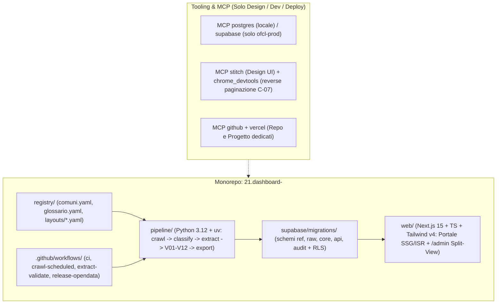

# Piano di Implementazione A→Z — Osservatorio Finanze Comunali del Locarnese (OFCL)

## Goal Description

Progettare e costruire da zero a produzione (**A→Z**), in un **nuovo repository completamente indipendente dal CRM Corfin** (`C:\Users\nicol\Desktop\progetti\21.dashboard-\`), un **portale civico pubblico di trasparenza e Open Data** per il monitoraggio finanziario armonizzato **MCA2** dei **19 Comuni del Distretto di Locarno** (codice distrettuale UST `2104`, codici comunali `5091–5399`).

Il sistema acquisisce i fascicoli contabili pubblici (Preventivi, Consuntivi con gli allegati ex art. 22 RGFCC, Piani Finanziari e Messaggi Municipali di credito d'investimento) dalle 5 configurazioni CMS comunali, estrae deterministicamente le tabelle contabili conservando coordinate geometriche (`page` + `bbox`) e stringa originale, esegue **12 controlli automatici di quadratura contabile (`V01–V12`)**, assiste il curatore in una console **Split-View PDF + Dati (`/admin`)** e pubblica su web, API REST e pacchetti Open Data (`CSV` / `Parquet`) soltanto cifre certificate e verificabili a 1 clic sul PDF ufficiale.

L'intera specifica tecnica e normativa è suddivisa in **15 documenti Markdown modulari** consultabili a partire dall'indice master [00-index.md](./docs/spec/00-index.md):
- **Prodotto & Criticità**: [01-prd.md](./docs/spec/01-prd.md) · [02-criticita-rischi.md](./docs/spec/02-criticita-rischi.md)
- **Architettura, DB & Connettori**: [03-architettura.md](./docs/spec/03-architettura.md) · [04-data-model.md](./docs/spec/04-data-model.md) · [05-fonti-connettori.md](./docs/spec/05-fonti-connettori.md)
- **Parsing PDF, Validazione & Crediti**: [06-estrazione-pdf.md](./docs/spec/06-estrazione-pdf.md) · [07-validation-engine.md](./docs/spec/07-validation-engine.md) · [08-crediti-cespiti-lifecycle.md](./docs/spec/08-crediti-cespiti-lifecycle.md)
- **UX, MCP & Testing**: [09-ux-portale-admin-opendata.md](./docs/spec/09-ux-portale-admin-opendata.md) · [10-mcp-evaluation.md](./docs/spec/10-mcp-evaluation.md) · [11-testing-qa-goldenset.md](./docs/spec/11-testing-qa-goldenset.md)
- **Legale, Ops & Roadmap Esecutiva**: [12-legal-compliance.md](./docs/spec/12-legal-compliance.md) · [13-operations-runbook.md](./docs/spec/13-operations-runbook.md) · [14-tasks-build-roadmap.md](./docs/spec/14-tasks-build-roadmap.md)

---

## User Review Required

Durante l'audit preliminare dell'ambiente e il probe HTTP live eseguito oggi sui 19 portali comunali sono emerse **4 criticità bloccanti** (dettagliate con le altre 20 in [02-criticita-rischi.md](./docs/spec/02-criticita-rischi.md)):

> [!CAUTION]
> **C-01 · Contaminazione Database MCP Supabase**: il server MCP `supabase` attualmente attivo punta a `https://vrqnbdcsavgpdgijpiic.supabase.co`, che è il **database di produzione del gestionale CRM Corfin**. Nessuna migrazione remota verrà mai lanciata via MCP finché non viene creato un progetto Supabase separato (`ofcl-prod`, regione Zurigo) o si opera esclusivamente sullo stack Docker locale (`supabase start` su `127.0.0.1:54322`) protetto dallo script guard `check-not-corfin.mjs`.

L'ispezione live dei `robots.txt` comunali ha evidenziato vincoli stringenti sull'acquisizione automatica:

> [!WARNING]
> **C-02 · Blocco `robots.txt` sulla Città di Locarno (`/files/`)**: il portale `www.locarno.ch` dichiara `User-agent: *` → `Disallow: /files/`, cartella dove risiedono tutti i PDF contabili. Per integrità legale e reputazionale di un portale civico, il crawler indicizzerà solo le pagine HTML consentite mentre i PDF di Locarno entreranno via caricamento manuale tracciato (`MANUAL_UPLOAD`) finché la Cancelleria non rilascerà autorizzazione scritta (Template A già pronto in [12-legal-compliance.md](./docs/spec/12-legal-compliance.md)).

Inoltre, il documento Word di partenza presenta **11 imprecisioni/eterogeneità verificate** che impongono una **Fase 0 di censimento su fonti primarie**:

> [!IMPORTANT]
> **C-03, C-04 & C-05 · Qualità Fonti, Eterogeneità PDF e Privacy nLPD**:
> 1. **Orselina (`5121`)** usa un motore Assolo legacy con token anti-manomissione obbligatorio `&vis=2&rif=<hmac>` (senza `rif` restituisce HTTP 404; vietato enumerare `id_doc`).
> 2. **Non tutti i PDF vengono da Ge.Co.Ti. Web** (es. tabulati *Seagate Crystal Reports* a Lavertezzo) e **3 indici** (Losone, Brione s/M, Centovalli) richiedono navigazione a 2 livelli o parametri form (`C-07`).
> 3. **Protezione dati personali (nLPD / LPDP)** e **diritto sugli stemmi (LPSt)**: in v1 i PDF restano in bucket **privato** (il pubblico apre il link ufficiale comunale `#page=N`), i Messaggi Municipali nominativi (naturalizzazioni, espropri, liti) sono filtrati a monte e gli stemmi araldici comunali non vengono mai utilizzati nella UI.
> 4. **Precisione contabile**: a differenza del gestionale artigiani (`0.05 CHF`), la contabilità pubblica **MCA2 opera rigorosamente al centesimo (`0.01 CHF`)**.

---

## Open Questions

Le scelte proposte di default nel piano (modificabili prima del via libera al codice) sono:
1. **Ambiente DB iniziale (Fase 1)**: partire subito su **Supabase CLI locale (Docker)** mentre crei con calma il progetto cloud `ofcl-prod`? *(Raccomandato: Sì, sblocca subito Fasi 0–4 a rischio zero).*
2. **Archivio PDF pubblico vs privato (C-04)**: confermi per l'MVP di mantenere le copie PDF nel **bucket privato** del curatore linkando al cittadino l'URL ufficiale comunale? *(Raccomandato: Sì).*
3. **Cartella di progetto (Confermata e attiva)**: `C:\Users\nicol\Desktop\progetti\21.dashboard-\` (isolata dal repository `20.sito-corfin`).

---

## Proposed Changes

L'architettura separa nettamente la **Pipeline Dati Python** (ottimale per estrazione geometrica PDF e validazione matematica) dal **Portale Civico + Console Curatore Next.js**, uniti dal contratto SQL su PostgreSQL/Supabase ([03-architettura.md](./docs/spec/03-architettura.md)).



---

### Componente 1 · Governance, Registry Territoriale & Guardrail MCP (`registry/`, `scripts/`)

Configurazione dichiarativa dei 19 Comuni, delle regole di cortesia HTTP (`Crawl-delay: 30s` Assolo) e dello scudo anti-contaminazione verso il DB Corfin ([05-fonti-connettori.md](./docs/spec/05-fonti-connettori.md), [10-mcp-evaluation.md](./docs/spec/10-mcp-evaluation.md)).

#### [NEW] AGENTS.md
Regole esecutive ADHD-friendly e 4 profili specializzati per OFCL (*Domain Expert MCA2/SEL*, *Data & Backend Architect*, *Civic Frontend & Accessibility Specialist*, *QA & Golden-Set Verifier*).

#### [NEW] check-not-corfin.mjs
Guard eseguita in pre-commit e CI: blocca qualsiasi comando se una variabile d'ambiente o config contiene il project-ref `vrqnbdcsavgpdgijpiic`.

#### [NEW] comuni.yaml
Anagrafica verificata dei 19 Comuni (`5091` Ascona … `5399` Verzasca), enti contabili separati (`COMUNE`, `AAP/ACAP`, `AE`, `APONA`, `LEA`, `CASA_ANZIANI`), strategia connettore, `mm_numbering` (`YEARLY_RESET` vs `SEQUENTIAL`), `crawl_delay_s` e URL canarino anti-drift.

#### [NEW] glossario.yaml
Sinonimi delle sezioni ex art. 22 RGFCC, mapping dicasteri `0–9` e blacklist lessicale anti-PII (`naturalizzazione`, `attinenza`, `esproprio`).

---

### Componente 2 · Database PostgreSQL, Vista Golden & Sicurezza RLS (`supabase/`)

Schema multi-livello che corregge i limiti di chiavi primarie piatte gestendo versioni multiple (proposta vs emendato CC), colonne storiche affiancate e provenienza geometrica per cella ([04-data-model.md](./docs/spec/04-data-model.md)).

#### [NEW] 0001_schemas_and_ref.sql
Schemi `ref`, `raw`, `core`, `api`, `audit` e tabelle di riferimento (`municipality`, `entity`, `account_mca2`, `function_mca2`, `population`, `tax_multiplier`, `indicator_def`, `indicator_scale` versionata con estremi esatti SEL).

#### [NEW] 0002_raw_and_core.sql
Tabelle `raw.source`, `raw.pipeline_run`, `raw.document`, `raw.document_version` (dedup `sha256`), `core.classification`, `core.ledger_value` (`amount_chf numeric(16,2)`, `amount_raw`, `page`, `bbox`), `core.investment_credit`, `core.credit_snapshot` (`overrun` calcolato), `core.asset_snapshot`, `core.indicator_value`, `core.validation_result`.

#### [NEW] 0003_audit_views_rls.sql
Tabella immutabile `audit.curator_action`, viste pubbliche `api.ledger_golden`, `api.summary_by_year`, `api.indicators`, `api.credits`, `api.documents`, `api.coverage` (`security_invoker = true`, filtro rigido `status = 'PUBLISHED' AND NOT contains_personal_data`) e policy RLS deny-by-default.

#### [NEW] rls_security.test.sql
Suite automatica `pgTAP` di test negativi sui permessi `anon`, `authenticated` generico e `curator`.

---

### Componente 3 · Pipeline Dati Python 3.12 (`pipeline/`)

Pacchetto CLI modulare `ofcl` gestito con `uv` ([06-estrazione-pdf.md](./docs/spec/06-estrazione-pdf.md), [07-validation-engine.md](./docs/spec/07-validation-engine.md), [08-crediti-cespiti-lifecycle.md](./docs/spec/08-crediti-cespiti-lifecycle.md)):

```python
# Esempio contratto parser numerico ticinese (precisione 0.01 CHF, zero arrotondamenti a 0.05)
def parse_chf(raw: str) -> Decimal | None:
    """Converte '15\\'432\\'147.41', '1\\'200.--', './. 35\\'000', '(450.20)' in Decimal al centesimo."""
```

#### [NEW] pyproject.toml
Configurazione `uv`, `ruff`, `mypy --strict`, `pytest`, `hypothesis`, `httpx`, `selectolax`, `protego`, `pdfplumber`, `pymupdf`, `pydantic`, `pandera`, `pyarrow`, `frictionless`.

#### [NEW] robots_guard.py & downloader.py
Verifica `robots.txt` bloccante, rate-limiter per dominio, richieste condizionali `ETag`, streaming `SHA-256` e salvataggio su bucket privato `raw-pdfs`.

#### [NEW] assolo.py, assolo_signed.py, wordpress.py, joomla_jdownloads.py, locarno_metadata.py
I 5 connettori specializzati per i 19 portali comunali con controllo canarino anti-drift.

#### [NEW] swiss_numbers.py, classifier.py, table_extractor.py, credits_extractor.py
Normalizzazione numeri/codici MCA2, classificatore a doppia passata (titolo + prime 3 pagine), estrattore tabellare guidato da coordinate YAML (`registry/layouts/`) con fallback `ocrmypdf` e algoritmo di Entity Resolution a 4 livelli per i crediti dell'Allegato f.

#### [NEW] rules.py & calculator.py
Motore delle 12 regole di quadratura `V01–V12` (`BLOCKING` / `WARNING`), generatori segnali `S01–S04` e ricalcolo trasparente degli 8 indicatori SEL.

#### [NEW] datapackage_builder.py & cli.py
Esportatore Frictionless Open Data (`CSV` standard, `CSV Excel-CH` con `;` e BOM, `Parquet`) ed entrypoint `ofcl crawl | extract | validate | export`.

---

### Componente 4 · Console Curatore & Portale Pubblico Next.js 15 (`web/`)

Applicazione Next.js 15 (App Router, React 19, Tailwind CSS v4) conforme **WCAG 2.1 AA**, con rendering statico/incrementale (`SSG`/`ISR`) per il pubblico e console protetta da MFA per il curatore ([09-ux-portale-admin-opendata.md](./docs/spec/09-ux-portale-admin-opendata.md)).

#### [NEW] ReviewSplitView.tsx (`/admin/review/[versionId]`)
Interfaccia di validazione rapida: visualizzatore PDF sincronizzato su `page` e rettangolo `bbox` a sinistra, griglia valori ed errori `V01–V12` a destra, scorciatoie da tastiera e scrittura obbligatoria in `audit.curator_action`.

#### [NEW] MunicipalityDashboard.tsx (`/comuni/[slug]`)
Scheda Comune progettata sulla *Regola dei 30 secondi*: KPI card con popover di provenienza (`MM`, pagina, link `#page=N`), barre degli 8 indicatori SEL (`reported` vs `computed`), ripartizione dicasteriale `0–8` e moltiplicatori `PF/PG`.

#### [NEW] ComparatorView.tsx (`/confronta`) & CreditsTracker.tsx (`/crediti`)
Confronto multi-comune ordinabile con fasce SEL e avvisi di perimetro; registro crediti d'investimento con filtro *"Solo sorpassi"* e distinzione Lordo vs Netto a carico del Comune.

#### [NEW] Route Handlers `/api/v1/*` & `/open-data`
Endpoint REST pubblici read-only paginati e pagina di download dei dataset certificati `CC BY 4.0`.

---

### Componente 5 · Automazione CI/CD & Cron Stagionale (`.github/workflows/`)

Quattro workflow GitHub Actions ([13-operations-runbook.md](./docs/spec/13-operations-runbook.md)):
#### [NEW] ci.yml, crawl-scheduled.yml, extract-validate.yml, release-opendata.yml

---

## Verification Plan

Strategia multilivello descritta integralmente in [11-testing-qa-goldenset.md](./docs/spec/11-testing-qa-goldenset.md) e legata ai gate delle 8 fasi in [14-tasks-build-roadmap.md](./docs/spec/14-tasks-build-roadmap.md).

### Automated Tests

```powershell
# 1. Guardrail isolamento assoluto dal DB Corfin (Fase 0)
node scripts/check-not-corfin.mjs

# 2. Lint, Typecheck strict, Unit + Property-Based Testing (5'000 casi CHF) e Connettori offline + Robots Gate (Fasi 2-3)
cd pipeline
uv run ruff check .
uv run mypy --strict src
uv run pytest tests/unit tests/connectors -v

# 3. Regressione Golden Set MCA2 su 25 PDF reali (Soglia: errore 0.00 CHF sui Riassunti Generali)
uv run pytest tests/golden -v --tb=short

# 4. Migrazioni SQL e Suite Negativa RLS su Supabase locale (Fase 1)
supabase db reset
supabase test db

# 5. Typecheck, Build, E2E Playwright + Audit WCAG 2.1 AA Axe sul Portale e Console Curatore (Fasi 4-6)
cd ../web
pnpm lint
pnpm build
pnpm exec playwright test

# 6. Validazione formale pacchetto Open Data Frictionless
cd ../pipeline
uv run frictionless validate dist/opendata/datapackage.json
```

### Manual Verification

1. **Verifica Isolamento Infrastrutturale (`C-01`)**: controllare che `supabase status` / dashboard punti esclusivamente all'istanza dedicata `ofcl` e che il workspace `20.sito-corfin` abbia `git status` completamente pulito.
2. **Collaudo Console Curatore Split-View (`US6`)**: caricare 1 Consuntivo reale (es. Losone MM 060 o Terre di Pedemonte MM 06/2026), cliccare 5 valori nella griglia destra e verificare che il PDF a sinistra salti esattamente alla pagina ed evidenzi il riquadro corretto.
3. **Audit Campione 5% Pre-Release (`NFR-05`)**: confrontare visivamente il 5% delle celle pubblicate su 5 Comuni diversi (incluso almeno 1 sorpasso in Allegato f e 1 moltiplicatore differenziato PF/PG come Locarno o Centovalli) contro i PDF ufficiali comunali: **0 discrepanze ammesse**.
4. **Test "Regola dei 30 Secondi" & Disclaimer Legale (`US1`, `FR-033`)**: aprire da smartphone una Scheda Comune, verificare leggibilità immediata di risultato, debito pro capite, semafori SEL, visibilità del disclaimer ex art. 192 LOC e assenza di stemmi ufficiali comunali.
